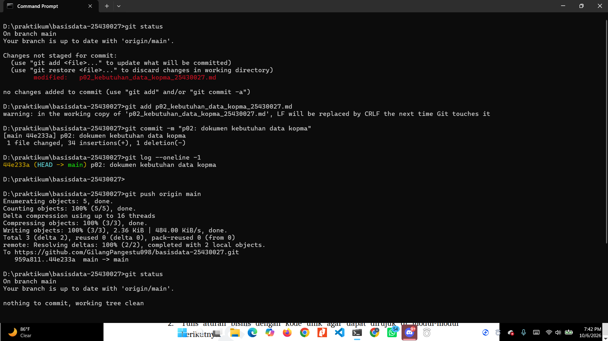
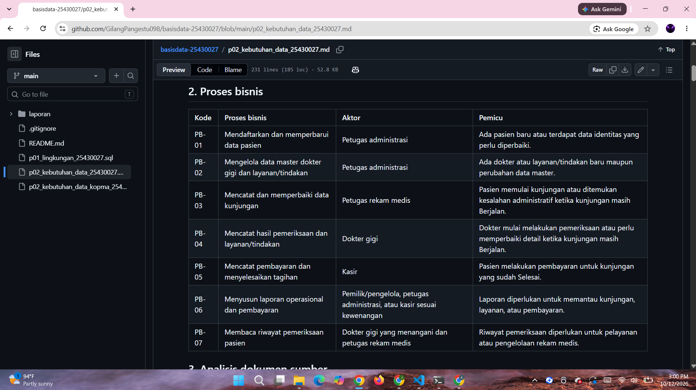
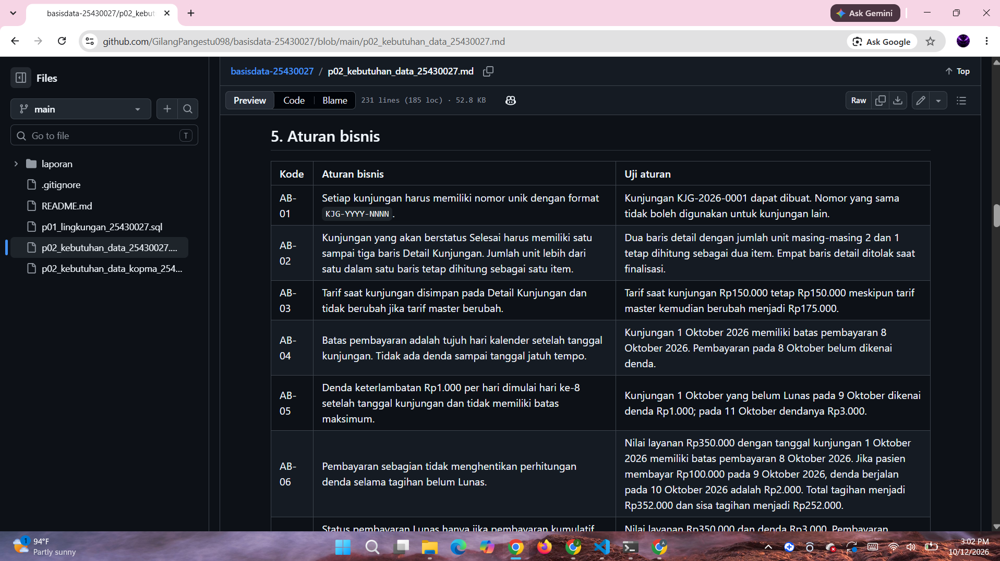
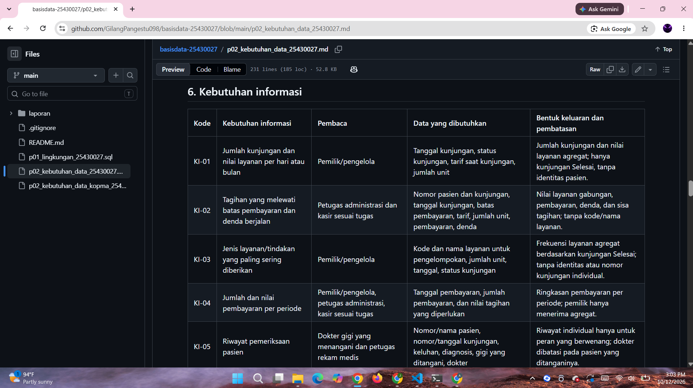
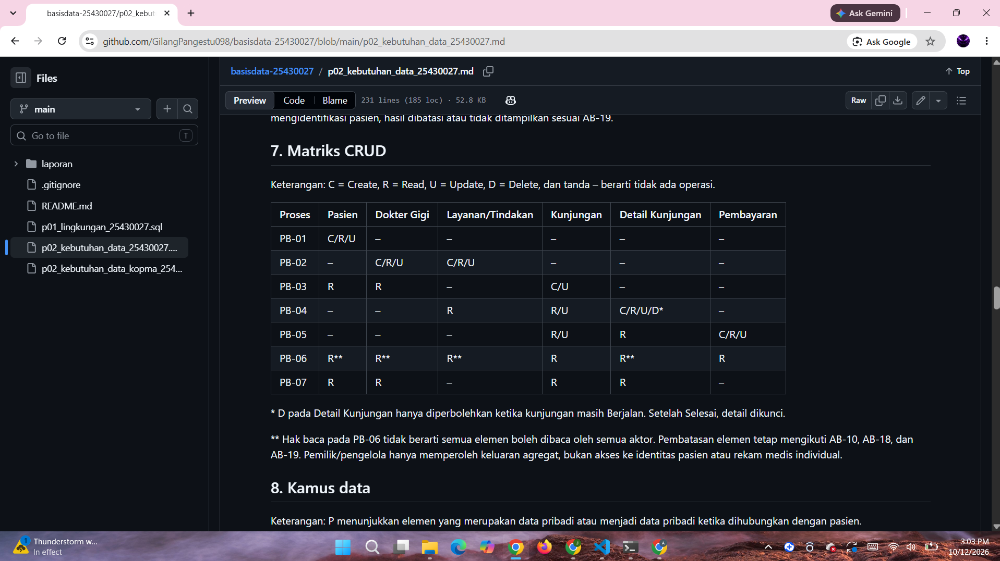
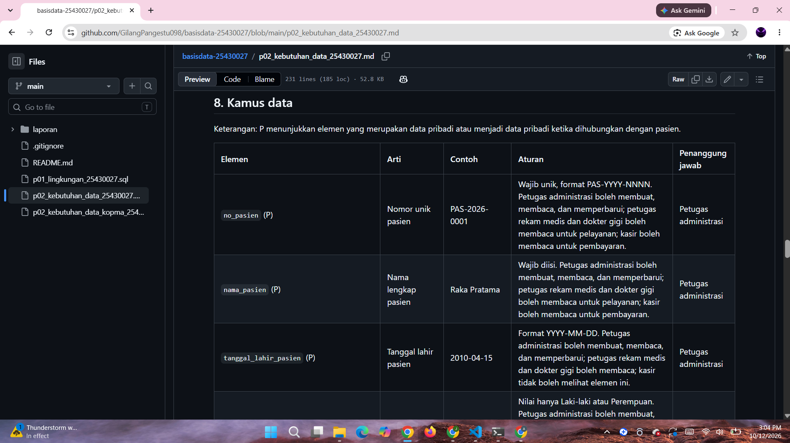

# Laporan Praktikum Basis Data - Pertemuan 2

**Nama:** Gilang Pangestu    **NIM:** 25430027    **Kelas:** A    **Tanggal:** [12 oktober 2026]

**Dosen:** Dedi Irawan S.Kom, M.T.I.

## 1. Tujuan Praktikum

Praktikum ini melatih saya menggali kebutuhan data sebelum merancang basis data. Dari narasi, wawancara, dan dokumen sumber, saya mengidentifikasi aktor dan proses bisnis, menurunkan entitas kandidat dan aturan bisnis, lalu menyusun matriks CRUD dan kamus data yang mencantumkan penanggung jawab data. Saya juga berlatih menulis kebutuhan yang spesifik dan dapat diuji, lalu menerapkan semuanya pada proyek pribadi bertema Klinik.

## 2. Ringkasan Dasar Teori

Perancangan basis data dimulai dari analisis kebutuhan, lalu berlanjut ke desain konseptual (ERD), desain logis (normalisasi), dan desain fisik (DDL). Kesalahan di tahap analisis paling mahal karena baru ketahuan di tahap akhir, misalnya harga lama yang hilang karena tidak disimpan per transaksi.

Data dipandang sebagai aset organisasi: data lahir dari aktivitas, punya penanggung jawab (data steward), punya aturan, dan harus dijaga mutunya. Kebutuhan digali dari wawancara, observasi, dokumen sumber, dan sistem lama, lalu dikelompokkan menjadi kebutuhan data, kebutuhan informasi, aturan bisnis, dan kebutuhan non-fungsional (volume, retensi, privasi). Matriks CRUD dipakai untuk memeriksa kelengkapan: entitas tanpa huruf C berarti ada proses yang terlewat. Kamus data menjadi bahasa bersama antara analis, pemrogram, dan pengguna. Pernyataan kebutuhan yang baik bersifat spesifik, terukur, dan dapat diuji.

## 3. Hasil Langkah Percobaan

Seluruh langkah D.1–D.7 saya tuangkan ke berkas `p02_kebutuhan_data_kopma_25430027.md` mengikuti kerangka dokumen kebutuhan data dari modul.

**D.2 Aktor dan proses bisnis.** Dari kata kerja pada narasi, saya memperoleh proses PB-01 sampai PB-05 (daftar anggota, catat penjualan, pesan ke pemasok, terima barang, laporan bulanan). PB-06 ditambahkan dari Latihan E.1, sedangkan PB-07 dan PB-08 ditambahkan dari Titik Analisis 3.

**D.3 Membedah dokumen sumber.** Nota PJ-2609-0142 memiliki 13 isian: 8 disimpan (termasuk relasi ke petugas, anggota, dan barang) dan 5 nilai turunan (subtotal, jumlah, diskon, total, kembali).

**D.4–D.6 Entitas, aturan bisnis, kebutuhan informasi, matriks CRUD, dan kamus data.** Dokumen Kopma memuat 7 entitas kandidat, aturan bisnis AB-01 sampai AB-13, kebutuhan informasi KI-01 sampai KI-07, matriks CRUD untuk 8 proses, dan kamus data awal.

**D.7 Commit dokumen Kopma**

Gambar ini memperlihatkan dokumen Kopma di-commit dengan pesan `p02: dokumen kebutuhan data kopma` (hash `44e233a`) lalu di-push ke GitHub sampai status *working tree clean*.

## 4. Jawaban Titik Analisis

**Titik Analisis 1**

Harga di data barang adalah harga terkini dan bisa berubah kapan saja. Jika nota hanya merujuk ke data barang, nota lama akan ikut menampilkan harga baru setelah harga naik, sehingga nilai transaksi dan omzet masa lalu menjadi salah. Ini persis keluhan ketua koperasi: "Harga barang sering naik, jadi kami bingung saat melihat nota lama." Karena itu, harga saat transaksi disimpan per baris nota (`harga_satuan_detail_penjualan`, AB-04) agar nota lama tetap menunjukkan harga yang benar-benar dibayar.

**Titik Analisis 2**

Alasan tidak menyimpan subtotal dan total adalah keduanya selalu bisa dihitung ulang dari qty, harga saat transaksi, dan diskon. Kalau disimpan, ada risiko nilai tersimpan tidak cocok dengan rinciannya, misalnya setelah qty dikoreksi tetapi total lupa diperbarui. Alasan yang mungkin membuat total tetap disimpan adalah kecepatan laporan: omzet harian (KI-01) untuk sekitar 150 nota per hari bisa dibaca langsung tanpa menjumlah ulang semua baris detail. Total yang tersimpan juga bisa menjadi bukti nilai yang benar-benar tercetak di nota. Keputusan akhirnya dibahas di Modul 4.

**Titik Analisis 3**

Kolom Pemasok tanpa huruf C berarti tidak ada proses yang membuat data pemasok, padahal PB-03 dan PB-04 membacanya. Akibatnya sistem akan membaca data yang tidak pernah dimasukkan, dan ini tanda ada proses yang terlewat. Saya menambahkan **PB-07 Mengelola data pemasok** dengan pelaku petugas gudang (C, R, U pada Pemasok), karena petugas gudang yang berhubungan dengan pemasok melalui pesanan dan faktur.

Status aktif anggota juga tidak diubah oleh proses mana pun, padahal status itu menentukan diskon 5% (AB-02) dan hak poin (AB-12). Saya menambahkan **PB-08 Mengubah status keanggotaan** dengan pelaku ketua koperasi (R, U pada Anggota). Ketua dipilih karena ia penanggung jawab data anggota di kamus data. Selain itu, status menentukan hak diskon, jadi keputusannya sebaiknya ada di pimpinan, bukan di kasir. Kasir cukup membaca status saat mencatat penjualan.

**Analisis wajib: perhitungan parameter P**

Dua digit terakhir NIM 25430027 adalah 27.

- P = (27 mod 9) + 1 = 0 + 1 = **1**
- Batas maksimal item per transaksi = P + 2 = **3 baris layanan per kunjungan** (AB-02 Klinik)
- Denda harian = P × Rp1.000 = **Rp1.000 per hari** (AB-05 Klinik)
- Perkiraan volume transaksi harian = 40 + 5 × P = **45 kunjungan per hari** (bagian 9.1 dokumen Klinik)

**Analisis wajib: perbaikan tiga pernyataan kebutuhan kabur** dijawab pada Latihan E.2 di bagian 5.

## 5. Hasil Latihan dan Modifikasi

**E.1 Poin loyalitas** (commit `b02e6f8`)

Saya menambahkan:

- empat elemen data yang disimpan: `saldo_poin_anggota`, `poin_diperoleh_penjualan`, `poin_digunakan_penjualan`, dan `potongan_poin_penjualan`;
- satu nilai turunan, yaitu `tagihan_penjualan`;
- aturan bisnis AB-07 sampai AB-13;
- kebutuhan informasi KI-05 sampai KI-07;
- proses PB-06 Menukar poin pada penjualan.

Contoh perhitungan: Jumlah Rp29.000, Diskon Rp1.450, Total Rp27.550, poin digunakan 50, potongan Rp5.000, tagihan Rp22.550, poin diperoleh 2.

Poin dihitung dari Jumlah (sebelum diskon). Contohnya, Jumlah Rp40.000 menghasilkan 4 poin, sedangkan jika dihitung dari Total Rp38.000 hanya menghasilkan 3 poin.

Saldo poin disimpan karena dibaca setiap transaksi. Poin per nota juga disimpan supaya nota lama tidak berubah jika aturan poin berubah, dan supaya saldo bisa direkonsiliasi dengan riwayat poin. Matriks CRUD diperbarui: PB-02 kini R, U pada Anggota, dan PB-06 R, U pada Anggota dan Penjualan.

**E.2 Perbaikan tiga pernyataan kebutuhan kabur** (commit `10073b0`)

| Pernyataan kabur | Versi yang dapat diuji (ringkas) |
|---|---|
| (a) "data anggota harus aman" | `no_hp_anggota` hanya boleh dilihat dan diubah ketua. Kasir boleh memasukkannya saat PB-01, tetapi tidak boleh melihatnya setelah anggota terdaftar. Petugas gudang tidak boleh melihatnya. Diuji dengan login sebagai ketua, kasir, dan petugas gudang. |
| (b) "sistem harus cepat mencari barang" | Pencarian lewat `kode_barang` atau sebagian `nama_barang` tampil paling lama 2 detik sejak Enter ditekan. Diuji dengan 20 pencarian (10 kode, 10 nama) pada 1.000 barang. |
| (c) "laporan stok harus akurat" | `stok_barang` = stok awal + penerimaan (PB-04) − penjualan (PB-02), dengan selisih 0. Diuji setiap sore pada sampel 20 barang. Tidak boleh ada stok negatif (AB-03), dan semua barang di bawah minimum harus muncul di KI-03. |

Rumusan lengkap ada di bagian 9 dokumen Kopma.

## 6. Tugas Mandiri: Milestone Proyek 2

- Berkas: `p02_kebutuhan_data_25430027.md`
- Organisasi fiktif: Klinik Gigi Sehat Ceria GP
- Dokumen sumber fiktif: Lembar Kunjungan. Dari 24 isian, 13 disimpan, 6 berupa relasi, dan 5 berupa nilai turunan.

| Ketentuan minimum | Minimum | Hasil |
|---|---|---|
| Proses bisnis | 4 | 7 (PB-01 – PB-07) |
| Entitas kandidat | 6 | 6 (Pasien, Dokter Gigi, Layanan/Tindakan, Kunjungan, Detail Kunjungan, Pembayaran) |
| Aturan bisnis | 8 | 19 (AB-01 – AB-19) |
| Kebutuhan informasi | 5 | 6 (KI-01 – KI-06) |
| Kamus data dengan penanggung jawab | 20 elemen | 31 elemen |
| Entitas tanpa C di CRUD | tidak boleh ada | tidak ada |
| Kebutuhan non-fungsional dan data pribadi | ada | bagian 9 (volume, retensi, privasi dan akses) |

**Keputusan desain utama:**

1. **Tarif disimpan per baris Detail Kunjungan (AB-03).** Perubahan tarif master tidak mengubah nilai kunjungan lama.
2. **Batas waktu pembayaran disimpan.** Kalau aturan jatuh tempo berubah, kunjungan lama tetap memakai jatuh tempo yang berlaku saat itu. Nilainya dihitung ulang hanya jika tanggal kunjungan dikoreksi saat status masih Berjalan (AB-14).
3. **Denda final disimpan saat Lunas, sedangkan denda berjalan dihitung.** Jika koreksi membuat tagihan kembali Belum Lunas, denda final dikosongkan (AB-11, AB-17).
4. **Pembayaran menjadi entitas sendiri.** Satu kunjungan dapat dicicil dengan beberapa pembayaran (AB-08), dan baris pembayaran tidak boleh dihapus (AB-16).
5. **Akses per elemen dan per peran.**
   - Data kesehatan hanya boleh dilihat dokter yang menangani dan petugas rekam medis (AB-10).
   - Kasir melihat tarif dan jumlah per baris untuk menghitung tagihan, tetapi tidak melihat kode atau nama layanan (AB-18).
   - Pemilik hanya menerima laporan agregat (AB-19).
6. **Retensi paling singkat 25 tahun sejak kunjungan terakhir**, mengikuti Permenkes Nomor 24 Tahun 2022 tentang Rekam Medis, Pasal 39 ayat (1).

**Bukti tampilan GitHub**

Tabel proses bisnis PB-01 sampai PB-07 pada dokumen Klinik di GitHub.

Tabel aturan bisnis beserta kolom uji aturannya (AB-01 sampai AB-06 terlihat).

Tabel kebutuhan informasi beserta pembaca dan pembatasan keluarannya.

Matriks CRUD tujuh proses terhadap enam entitas. Setiap entitas memiliki huruf C.

Kamus data dengan kolom penanggung jawab dan penanda data pribadi (P).

## 7. Pembahasan dan Kendala

Modul ini tidak memakai XAMPP, sehingga "galat" yang muncul berupa ketidaksesuaian di dokumen dan kendala Git.

**Kendala 1: Berkas Klinik masih berupa kerangka kosong**

- **Yang terlihat:** `dir p02_*.md` menunjukkan `p02_kebutuhan_data_25430027.md` hanya berukuran 459 byte, dan `git status` menampilkannya sebagai *untracked*.
- **Penyebab:** Yang tersimpan di folder repositori baru kerangka bagiannya. Isi dokumen masih ada di berkas lain (versi HTML).
- **Cara mengatasi:** Isi dokumen dikonversi ke Markdown, lalu isi berkas kerangka diganti. Hasilnya diperiksa di pratinjau VS Code (Ctrl+Shift+V), lalu di-commit sebagai `00c71af`.

**Kendala 2: Ukuran berkas tidak sesuai perkiraan**

- **Yang terlihat:** Setelah isi diganti, ukurannya 30.828 byte, padahal hasil konversi berukuran sekitar 54 KB.
- **Penyebab:** Selisih ukuran bisa berarti isinya terpotong, atau hanya spasi pelurus tabel yang hilang. Dari angkanya saja tidak bisa dibedakan.
- **Cara mengatasi:** Kelengkapan isi diperiksa dengan `find /c /v ""` untuk jumlah baris, `findstr /b "#"` untuk 16 judul bagian, dan `findstr /b /c:"| AB-"` untuk 19 aturan bisnis. Setelah itu berkas ditimpa dengan berkas hasil konversi agar isinya identik.

**Kendala 3: Draf DDL ter-commit terlalu awal** 

- **Yang terlihat:** Riwayat Git memuat commit `7d5e8ec` "Menyelesaikan Modul 2 DDL…". Isinya pekerjaan DDL milik Modul 5, dan pesannya tidak mengikuti format `pNN: ...`.
- **Penyebab:** Draf DDL proyek ikut ter-commit sebelum waktunya.
- **Cara mengatasi:** Draf dipindahkan ke arsip lokal pada commit `084f733` (`p02: pindahkan draf DDL ke arsip lokal (dikerjakan di modul 5)`). Draf akan dipakai kembali di Modul 5.

**Pemeriksaan konsistensi dokumen.** Saat diperiksa terhadap checklist modul, ditemukan beberapa ketidaksesuaian:

- matriks CRUD tidak menandai bahwa kasir membaca data pasien pada PB-05, padahal kamus data mengizinkannya;
- judul bagian berbeda dari kerangka modul;
- contoh AB-07 Kopma salah hitung;
- kolom Pemasok tidak memiliki huruf C.

Semuanya diperbaiki pada commit `235a999`. Peringatan `LF will be replaced by CRLF` saat `git add` bukan galat. Peringatan itu hanya pemberitahuan format akhir baris di Windows dan tidak mengubah isi berkas.

## 8. Kesimpulan

Analisis kebutuhan menentukan kualitas seluruh rancangan berikutnya, karena keputusan seperti menyimpan harga atau tarif saat transaksi harus diambil sebelum data tercatat. Matriks CRUD terbukti efektif menemukan proses yang terlewat, seperti tidak adanya proses yang membuat data pemasok. Pada proyek Klinik, tantangan utamanya adalah membatasi akses data kesehatan per peran sambil tetap memungkinkan kasir menghitung tagihan dan denda dengan benar.

## 9. Pernyataan Penggunaan AI

Saya menggunakan alat bantu AI, yaitu Claude (Anthropic) dan ChatGPT, dengan rincian berikut:

- **Claude:**
  - membimbing langkah Git dan GitHub serta menafsirkan ketentuan modul (checklist, rubrik, format laporan);
  - memeriksa Latihan E, Titik Analisis, dan rancangan Klinik, lalu memberi umpan balik berupa pertanyaan dan penunjukan ketidakkonsistenan;
  - menyediakan baris PB-06 dan baris entitas Barang pada dokumen Kopma, teks terformat E.2, kerangka berkas Klinik, serta konversi berkas Klinik dari HTML ke Markdown;
  - memperbaiki kedua dokumen pada commit `235a999`: judul bagian, hak baca Pasien pada PB-05, alasan penyimpanan batas waktu pembayaran, retensi 25 tahun, contoh AB-07, elemen poin di kamus data, serta PB-07 dan PB-08;
  - menyusun draf laporan ini, termasuk draf jawaban Titik Analisis 1–3.
 - **ChatGPT:** dipakai ketika batas pesan Claude habis, untuk mencari ide serta merapikan redaksi dan tabel pada dokumen Klinik.
- **Rancangan dokumen Klinik:** pemilihan entitas, aturan bisnis, aturan denda, dan hak akses per peran saya tentukan sendiri, dengan sebagian ide dari ChatGPT. Hasilnya saya tinjau dan perbaiki berdasarkan pemeriksaan Claude.

Seluruh perintah Git (add, commit, push) dan pemeriksaan berkas saya jalankan sendiri. Tangkapan layar adalah hasil pekerjaan saya sendiri. Isi laporan sudah saya periksa dan saya pahami sebelum dikumpulkan.

## 10. Bukti Git

- Repositori: https://github.com/GilangPangestu098/basisdata-25430027

| Hash Commit | Pesan Commit |
| --- | --- |
| `235a999` | p02: dokumen kebutuhan data klinik dan perbaikan kopma |
| `2a77100` | p02: bukti tampilan github dokumen klinik |
| `00c71af` | p02: dokumen kebutuhan data klinik |
| `b02e6f8` | p02: latihan poin loyalitas kopma |
| `10073b0` | p02: latihan E.2 perbaiki kebutuhan kabur |
| `623f6d2` | p02: bukti commit kopma |
| `44e233a` | p02: dokumen kebutuhan data kopma |
| `959a811` | p02: dokumen kebutuhan data kopma |
| `084f733` | p02: pindahkan draf DDL ke arsip lokal (dikerjakan di modul 5) |

## Checklist

**Tabel 2.9 Checklist khusus laporan Pertemuan 2**

| Status | Jenis | Yang harus ada |
| :----: | :---- | :---- |
| ☑️ | Berkas wajib | `p02_kebutuhan_data_kopma_<NIM>.md` dan `p02_kebutuhan_data_<NIM>.md` (proyek) |
| ☑️ | Bukti tangkapan layar | Tabel PB, AB, KI, matriks CRUD, dan kamus data di berkas proyek (tangkapan tampilan GitHub) |
| ☑️ | Analisis wajib | Titik Analisis 1–3; perhitungan parameter P; perbaikan tiga pernyataan kebutuhan kabur |

### Tabel P.13 Checklist umum laporan praktikum

| Status | Butir | Yang harus ada |
| :----: | :---- | :---- |
| ☑️ | Identitas | Nama, NIM, kelas, pertemuan ke-N, tanggal pelaksanaan, nama asisten/dosen |
| ☑️ | Tujuan | Tujuan praktikum ditulis ulang dengan bahasa sendiri (maksimal 5 baris) |
| ☑️ | Ringkasan teori | Pemahaman sendiri atas Dasar Teori, maksimal setengah halaman, tanpa menyalin buku |
| ☑️ | Langkah percobaan (D) | Tangkapan layar hasil langkah kunci sesuai checklist khusus, masing-masing diberi keterangan singkat |
| ☑️ | Titik Analisis | Semua Titik Analisis dijawab lengkap dengan alasan, bukan sekadar ya/tidak |
| ☑️ | Latihan (E) | Skrip/dokumen hasil latihan beserta bukti berjalan |
| ☑️ | Tugas Mandiri (F) | Milestone proyek pertemuan ini: berkas, bukti, dan penjelasan keputusan desain |
| ☑️ | Pembahasan dan kendala | Galat yang ditemui, cara membacanya, dan cara mengatasinya |
| ☑️ | Kesimpulan | Dua sampai empat kalimat dengan bahasa sendiri |
| ☑️ | Pernyataan Penggunaan AI | Alat yang dipakai, untuk apa, bagian mana; tulis "tidak menggunakan" bila tidak memakai |
| ☑️ | Bukti Git | Tautan repositori dan kode commit (hash) pertemuan ini dengan pesan pNN: ... |
| ☑️ | Keaslian | Setiap tangkapan layar memperlihatkan akun ber-NIM dan jam sistem; nama objek memuat NIM/inisial |
