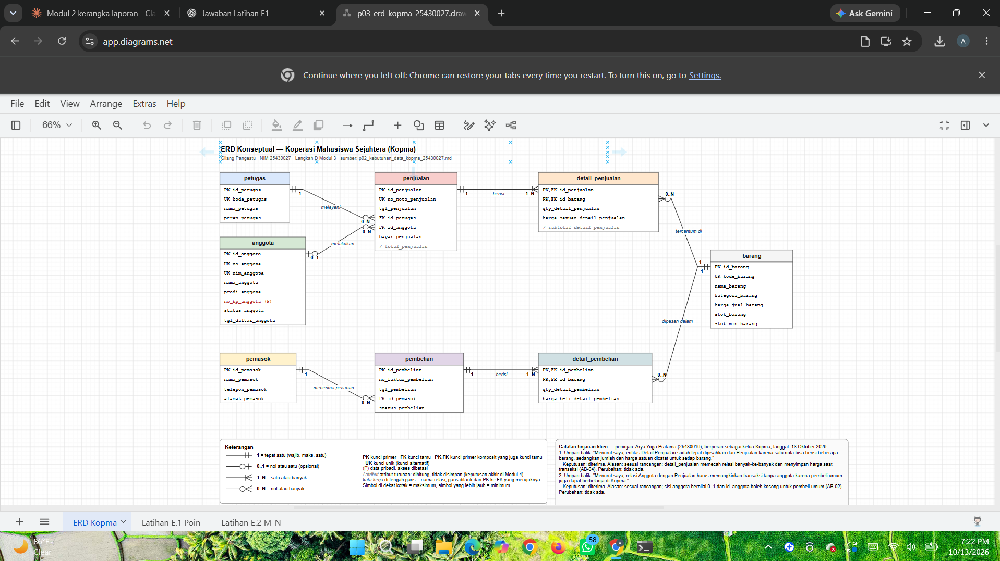
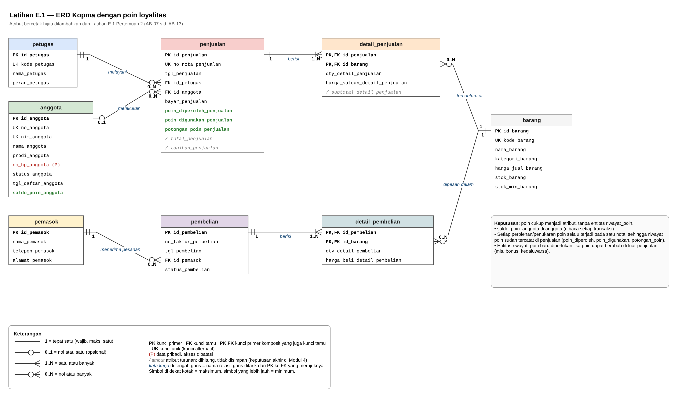
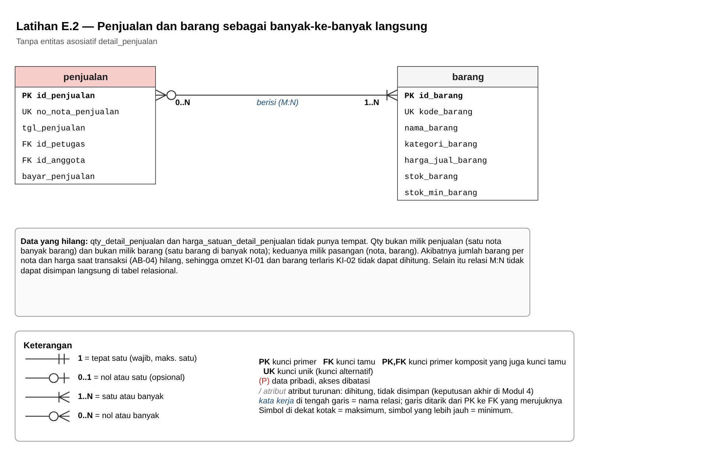
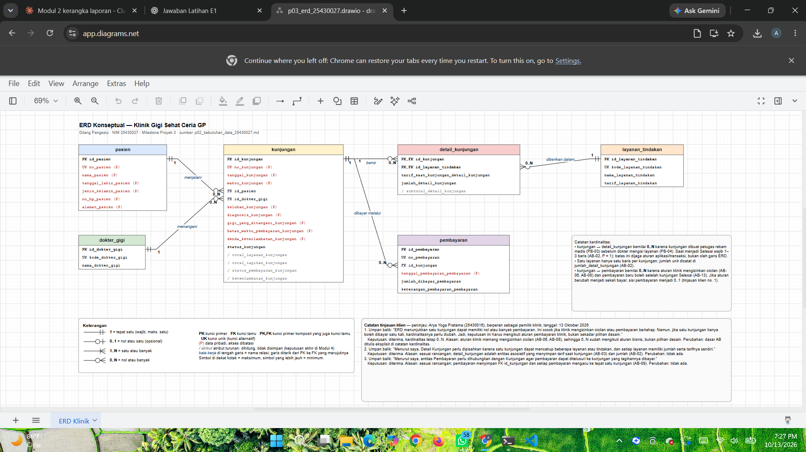

# Laporan Praktikum Basis Data - Pertemuan 3

**Nama:** Gilang Pangestu    **NIM:** 25430027    **Kelas:** A    **Tanggal:** 13 Oktober 2026

**Dosen:** Dedi Irawan S.Kom, M.T.I.

## 1. Tujuan Praktikum

Praktikum ini melatih saya mengubah dokumen kebutuhan data dari Pertemuan 2 menjadi ERD konseptual. Saya menentukan entitas, atribut, kunci primer, kunci alternatif, dan kunci tamu. Saya juga menentukan kardinalitas setiap relasi berdasarkan aturan bisnis, memecah relasi banyak-ke-banyak menjadi entitas asosiatif, menggambar ERD dengan notasi Crow's Foot di draw.io, dan memvalidasinya terhadap kebutuhan informasi.

## 2. Ringkasan Dasar Teori

ERD menggambarkan data sebagai **entitas** (hal yang dicatat), **atribut** (sifatnya), dan **relasi** (hubungan antarentitas). ERD konseptual belum memuat tipe data. Tipe data baru ditentukan di desain fisik (Modul 5).

**Kunci primer** dipilih yang unik, wajib ada, dan tidak pernah berubah. Karena itu buku ini memakai kunci pengganti `id_*`. Nomor alami seperti NIM atau nomor nota dijadikan **kunci alternatif (UK)**.

**Kardinalitas** menyatakan jumlah maksimum, dan **partisipasi** menyatakan apakah relasi wajib (minimum). Notasi Crow's Foot menggabungkan keduanya di ujung garis: simbol yang dekat kotak menyatakan maksimum, simbol yang lebih jauh menyatakan minimum. Setiap ujung garis harus bisa ditelusuri ke aturan bisnis.

Relasi **banyak-ke-banyak** tidak bisa disimpan langsung di tabel relasional, apalagi bila relasinya punya atribut sendiri. Relasi seperti ini dipecah dengan **entitas asosiatif** yang berelasi satu-ke-banyak ke kedua entitas asalnya. Kunci tamu selalu diletakkan di sisi "banyak".

## 3. Hasil Langkah Percobaan

**D.1 Dari entitas kandidat ke entitas.** Dari tabel entitas kandidat Kopma, saya menandai kunci primer, kunci alternatif, dan atribut turunan:

| Entitas | Kunci primer | Kunci alternatif (UK) | Atribut turunan |
|---|---|---|---|
| anggota | `id_anggota` | `no_anggota`, `nim_anggota` (AB-05) | – |
| barang | `id_barang` | `kode_barang` | – |
| penjualan | `id_penjualan` | `no_nota_penjualan` (AB-01) | `total_penjualan` |
| detail_penjualan | (`id_penjualan`, `id_barang`) | – | `subtotal_detail_penjualan` |

**D.2 Memecah pembelian.** Entitas kandidat "Pembelian dan detailnya" saya pecah menjadi `pembelian` dan `detail_pembelian`. Nomor faktur, tanggal, dan pemasok muncul sekali per faktur, sedangkan barang, qty, dan harga beli berulang per faktur. Polanya sama seperti penjualan dan detail_penjualan. Hasilnya, Kopma memiliki 8 entitas.

**D.3–D.4 Relasi dan kardinalitas Kopma.**

| Relasi | Sisi kiri | Sisi kanan | Dasar |
|---|---|---|---|
| petugas **melayani** penjualan | tepat satu petugas | nol atau banyak penjualan | wawancara kasir |
| anggota **melakukan** penjualan | nol atau satu anggota | nol atau banyak penjualan | AB-02 |
| penjualan **berisi** detail_penjualan | tepat satu penjualan | satu atau banyak detail | AB-01 |
| barang **tercantum di** detail_penjualan | tepat satu barang | nol atau banyak detail | AB-04 |
| pemasok **menerima pesanan** pembelian | tepat satu pemasok | nol atau banyak pembelian | AB-06 |
| pembelian **berisi** detail_pembelian | tepat satu pembelian | satu atau banyak detail | faktur pemasok |
| barang **dipesan dalam** detail_pembelian | tepat satu barang | nol atau banyak detail | faktur pemasok |

**D.5–D.6 Menggambar ERD Kopma.** ERD digambar di draw.io dan disimpan sebagai `p03_erd_kopma_25430027.drawio` (sumber) dan `p03_erd_kopma_25430027.png` (gambar). Sesuai standar Tabel 3.3:
- nama tabel huruf kecil dengan satu warna per entitas;
- semua kolom tercantum dengan label PK, FK, dan PK,FK;
- kedua ujung garis memakai simbol Crow's Foot dan label angka;
- garis ditarik dari PK ke FK;
- legenda ada di bagian bawah.

Tangkapan layar ERD Kopma di draw.io memperlihatkan 8 tabel, 7 relasi dengan label kardinalitas, dan legenda.

**D.7–D.8 Validasi terhadap kebutuhan informasi Kopma.**

| KI | Kebutuhan | Jalur di ERD |
|---|---|---|
| KI-01 | Omzet dan jumlah nota per hari/bulan | penjualan → detail_penjualan |
| KI-02 | Lima barang terlaris per bulan | barang → detail_penjualan → penjualan |
| KI-03 | Barang di bawah stok minimum | barang |
| KI-04 | Sepuluh anggota belanja terbesar | anggota → penjualan → detail_penjualan |
| KI-05 | Saldo poin setiap anggota | anggota (Latihan E.1) |
| KI-06 | Poin diperoleh dan digunakan per bulan | anggota → penjualan (Latihan E.1) |
| KI-07 | Anggota yang dapat menukar poin | anggota (Latihan E.1) |

Semua KI dapat ditelusuri. KI-05 sampai KI-07 baru terpenuhi setelah atribut poin dari Latihan E.1 ditambahkan.

**D.9 Tinjauan klien.** ERD Kopma ditinjau oleh Arya Yoga Pratama (25430016) sebagai ketua Kopma, dengan 2 umpan balik. Keputusannya tercatat di kotak bawah berkas ERD Kopma dan di bagian 6.5.

## 4. Jawaban Titik Analisis

**Titik Analisis 1**

Kunci primer dipakai sebagai rujukan oleh tabel lain, jadi nilainya harus stabil dan tidak pernah berubah. `no_anggota` dan `nim_anggota` memang unik, tetapi keduanya data bisnis yang bisa salah ketik atau berubah format. Karena itu buku memakai `id_anggota`, angka urut buatan sistem, dan menjadikan keduanya kunci alternatif.

Risiko jika NIM dijadikan kunci primer: kalau NIM seorang anggota ternyata salah ketik saat pendaftaran padahal ia sudah punya puluhan nota, setiap nota itu menyimpan NIM yang salah sebagai kunci tamu. Membetulkannya berarti mengubah banyak baris di dua tabel sekaligus. Kalau ada yang terlewat, nota kehilangan pemiliknya. Dengan `id_anggota`, cukup satu baris di tabel anggota yang diubah.

**Titik Analisis 2**

Aturan yang memaksa sisi detail bernilai satu atau banyak adalah **AB-01**: setiap nota memiliki nomor unik dan minimal satu baris barang.

Aturan "minimal satu" ini **tidak dapat dijaga oleh struktur tabel saja**. Kunci tamu di `detail_penjualan` hanya memastikan setiap detail punya nota, bukan sebaliknya. Database tetap mengizinkan baris `penjualan` tanpa satu pun detail. Aturan ini baru bisa dijaga dengan **transaksi** (Modul 14): nota dan seluruh detailnya disimpan bersama, dan kalau detail gagal disimpan, nota ikut dibatalkan.

**Titik Analisis 3**

ERD saat ini **belum dapat** menjawab "petugas gudang mana yang menerima barang dari pemasok", karena tabel `pembelian` hanya menyimpan pemasok, bukan petugas.

Relasi yang perlu ditambahkan adalah **petugas menerima pembelian**, dengan kunci tamu `id_petugas_penerima` di `pembelian`. Kardinalitasnya:
- sisi petugas **nol atau satu**, karena pesanan yang belum datang belum punya penerima;
- sisi pembelian **nol atau banyak**, karena satu petugas gudang dapat menerima banyak pembelian.

Keputusan ini **perlu dicatat sebagai aturan bisnis baru** supaya relasinya punya dasar. Usulannya: *AB-14: setiap pembelian berstatus "diterima" wajib mencatat petugas gudang yang menerimanya.* Relasi ini tidak saya masukkan ke ERD Kopma utama, karena ERD utama mengikuti skema kanonik modul (Lampiran C) yang menjadi acuan DDL di Modul 5.

## 5. Hasil Latihan dan Modifikasi

**E.1 Poin loyalitas pada ERD Kopma**

Poin cukup menjadi **atribut**, tanpa entitas riwayat poin. Keputusan ini sesuai dokumen kebutuhan Pertemuan 2:
- `saldo_poin_anggota` disimpan di `anggota`, karena dibaca setiap transaksi untuk memeriksa apakah penukaran boleh (AB-09).
- `poin_diperoleh_penjualan`, `poin_digunakan_penjualan`, dan `potongan_poin_penjualan` disimpan di `penjualan`. Setiap perolehan maupun penukaran poin selalu terjadi pada **satu nota**, sehingga riwayat poin sudah tercatat per nota dan saldo dapat direkonsiliasi dari riwayat itu.
- `tagihan_penjualan` adalah atribut turunan (Total dikurangi potongan poin).

Entitas riwayat poin baru diperlukan jika poin dapat berubah **di luar penjualan**, misalnya bonus atau poin kedaluwarsa. Kebutuhan seperti itu tidak ada di aturan bisnis Kopma.

**E.2 Penjualan dan barang sebagai banyak-ke-banyak langsung**

Tanpa entitas asosiatif, `qty_detail_penjualan` dan `harga_satuan_detail_penjualan` tidak punya tempat:
- Atribut itu bukan milik penjualan, karena satu nota berisi banyak barang.
- Atribut itu juga bukan milik barang, karena satu barang muncul di banyak nota.
- Atribut itu milik **pasangan** (nota, barang).

Akibatnya, jumlah barang per nota dan harga saat transaksi (AB-04) hilang, sehingga omzet (KI-01) dan barang terlaris (KI-02) tidak dapat dihitung. Selain itu, relasi banyak-ke-banyak tidak dapat disimpan langsung di tabel relasional.

## 6. Tugas Mandiri: Milestone Proyek 3

Berkas: `p03_erd_25430027.drawio`, `p03_erd_25430027.png`, dan dokumen pendamping `p03_erd_25430027.md`.

### 6.1 ERD proyek Klinik Gigi Sehat Ceria GP

ERD terdiri atas 6 entitas: pasien, dokter_gigi, layanan_tindakan, kunjungan, detail_kunjungan, dan pembayaran. Seluruh **31 elemen kamus data** Pertemuan 2 tercantum. Lima elemen kunci tamu yang di kamus ditulis memakai nomor alami (misalnya `no_pasien_kunjungan`) diwujudkan sebagai kunci tamu `id_*` (misalnya `kunjungan.id_pasien`). Atribut turunan diberi tanda `/` dan tidak disimpan.

### 6.2 Relasi dan kardinalitas

| Relasi | Sisi kiri | Sisi kanan | Dasar |
|---|---|---|---|
| pasien **menjalani** kunjungan | tepat satu pasien | nol atau banyak kunjungan | AB-20 |
| dokter_gigi **menangani** kunjungan | tepat satu dokter gigi | nol atau banyak kunjungan | AB-20, AB-10 |
| kunjungan **berisi** detail_kunjungan | tepat satu kunjungan | nol atau banyak detail (1–3 saat Selesai) | AB-02, AB-15 |
| layanan_tindakan **diberikan dalam** detail_kunjungan | tepat satu layanan | nol atau banyak detail | AB-03 |
| kunjungan **dibayar melalui** pembayaran | tepat satu kunjungan | nol atau banyak pembayaran | AB-08, AB-09, AB-13 |

**Alasan kardinalitas relasi utama:**
- **kunjungan → detail_kunjungan bernilai 0..N, bukan 1..N.** Kunjungan dibuat petugas rekam medis (PB-03) sebelum dokter mencatat layanan (PB-04), jadi selama status Berjalan, kunjungan sah tanpa detail. Batas 1–3 baris saat Selesai (AB-02, P + 2 = 3) dijaga oleh aturan saat finalisasi, bukan oleh garis ERD.
- **kunjungan → pembayaran bernilai 0..N.** Pembayaran hanya boleh untuk kunjungan Selesai (AB-13), sehingga kunjungan Berjalan belum punya pembayaran. Pasien juga boleh mencicil (AB-08). Setiap pembayaran mengacu ke tepat satu kunjungan (AB-09).
- **Sisi pasien dan dokter bernilai tepat satu.** Kunjungan tanpa pasien atau dokter tidak bermakna. Aturan ini saya catat sebagai **AB-20**, yang ditambahkan ke dokumen kebutuhan data pada pertemuan ini karena sebelumnya relasi tersebut belum punya dasar aturan bisnis.

### 6.3 Entitas asosiatif

`detail_kunjungan` memecah relasi banyak-ke-banyak antara kunjungan dan layanan_tindakan. Entitas ini memiliki atribut sendiri, yaitu `tarif_saat_kunjungan_detail_kunjungan` (AB-03) dan `jumlah_detail_kunjungan` (AB-02), dengan kunci primer komposit (`id_kunjungan`, `id_layanan_tindakan`).

### 6.4 Penelusuran KI dan pemetaan entitas

| KI | Jalur di ERD |
|---|---|
| KI-01 Jumlah kunjungan dan nilai layanan | kunjungan → detail_kunjungan |
| KI-02 Tagihan lewat batas dan denda berjalan | pasien → kunjungan → detail_kunjungan; kunjungan → pembayaran |
| KI-03 Layanan paling sering diberikan | layanan_tindakan → detail_kunjungan → kunjungan |
| KI-04 Jumlah dan nilai pembayaran per periode | pembayaran → kunjungan → detail_kunjungan |
| KI-05 Riwayat pemeriksaan pasien | pasien → kunjungan → dokter_gigi |
| KI-06 Kunjungan yang belum Lunas | pasien → kunjungan → detail_kunjungan; kunjungan → pembayaran |

| Entitas | Dibuat oleh (C) | Dipakai di KI |
|---|---|---|
| pasien | PB-01 | KI-02, KI-05, KI-06 |
| dokter_gigi | PB-02 | KI-05 |
| layanan_tindakan | PB-02 | KI-03 |
| kunjungan | PB-03 | KI-01 – KI-06 |
| detail_kunjungan | PB-04 | KI-01, KI-02, KI-03, KI-04, KI-06 |
| pembayaran | PB-05 | KI-02, KI-04, KI-06 |

Keenam KI dapat ditelusuri, dan setiap entitas dibuat oleh tepat satu proses bisnis. Rincian lengkapnya ada di `p03_erd_25430027.md`.

### 6.5 Catatan tinjauan klien

**Peninjau:** Arya Yoga Pratama (NIM 25430016)
**Peran:** teman sekelas yang berperan sebagai ketua Kopma (ERD Kopma) dan pemilik klinik (ERD Klinik)
**Tanggal:** 13 Oktober 2026

Umpan balik Klinik nomor 3 diberikan lewat WhatsApp. Umpan balik lainnya diketik langsung oleh peninjau. Catatan yang sama tertulis di kotak bagian bawah masing-masing berkas ERD.

| No | ERD | Umpan balik (apa adanya) | Keputusan | Alasan | Perubahan pada ERD |
|---|---|---|---|---|---|
| 1 | Kopma | "Menurut saya, entitas Detail Penjualan sudah tepat dipisahkan dari Penjualan karena satu nota bisa berisi beberapa barang, sedangkan jumlah dan harga satuan dicatat untuk setiap barang." | Diterima | Sesuai rancangan. detail_penjualan adalah entitas asosiatif yang memecah relasi banyak-ke-banyak penjualan–barang dan menyimpan qty serta harga saat transaksi (AB-04). | Tidak ada (sudah sesuai) |
| 2 | Kopma | "Menurut saya, relasi Anggota dengan Penjualan harus memungkinkan transaksi tanpa anggota karena pembeli umum juga dapat berbelanja di Kopma." | Diterima | Sesuai rancangan. Sisi anggota bernilai 0..1 dan id_anggota di penjualan boleh kosong untuk pembeli umum (AB-02). | Tidak ada (sudah sesuai) |
| 3 | Klinik | "Menurut saya, Detail Kunjungan perlu dipisahkan karena satu kunjungan dapat mencakup beberapa layanan atau tindakan, dan setiap layanan memiliki jumlah serta tarifnya sendiri." | Diterima | Sesuai rancangan. detail_kunjungan adalah entitas asosiatif yang menyimpan tarif saat kunjungan (AB-03) dan jumlah unit (AB-02) untuk setiap layanan. | Tidak ada (sudah sesuai) |
| 4 | Klinik | "Menurut saya, entitas Pembayaran perlu dihubungkan dengan Kunjungan agar pembayaran dapat ditelusuri ke kunjungan yang tagihannya dibayar." | Diterima | Sesuai rancangan. pembayaran menyimpan FK id_kunjungan dan setiap pembayaran mengacu ke tepat satu kunjungan (AB-09), sehingga KI-02, KI-04, dan KI-06 dapat ditelusuri. | Tidak ada (sudah sesuai) |
| 5 | Klinik | "ERD menunjukkan satu kunjungan dapat memiliki nol atau banyak pembayaran. Ini cocok jika klinik mengizinkan cicilan atau pembayaran bertahap. Namun, jika satu kunjungan hanya boleh dibayar satu kali, kardinalitasnya perlu diubah. Jadi, keputusan ini harus mengikuti aturan pembayaran klinik, bukan sekadar pilihan desain." | Diterima, kardinalitas tetap 0..N | Kardinalitas memang harus mengikuti aturan klinik. Aturan klinik mengizinkan pembayaran sebagian dan beberapa transaksi per kunjungan (AB-06, AB-08), dan pembayaran baru boleh setelah kunjungan Selesai (AB-13). Jadi 0..N sudah sesuai aturan bisnis; jika klinik kelak mewajibkan sekali bayar, sisi pembayaran menjadi 0..1. | Kardinalitas tidak diubah. Dasar AB-06, AB-08, dan AB-13 ditulis eksplisit di catatan kardinalitas ERD. |

Empat dari lima umpan balik membenarkan keputusan desain yang sudah ada: entitas asosiatif detail_penjualan dan detail_kunjungan, relasi anggota–penjualan 0..1, serta FK pembayaran ke kunjungan. Umpan balik Klinik nomor 3 paling berguna, karena menegaskan bahwa kardinalitas harus berasal dari aturan bisnis, bukan selera perancang. Komentar itu membuat saya menuliskan dasar AB pembayaran secara eksplisit di ERD.

## 7. Pembahasan dan Kendala

Di Modul 3 tidak ada galat dari server, karena pekerjaannya menggambar ERD. Kendala yang muncul berasal dari penggunaan draw.io dan terminal.

**Kendala 1: Garis relasi menempel di baris yang salah**
- **Yang terlihat:** Saat latihan menarik garis petugas → penjualan, garis tersambung dari `kode_petugas` ke `no_nota_penjualan`, bukan dari `id_petugas` (PK) ke `id_petugas` (FK).
- **Penyebab:** Baris tabel di draw.io rapat, sehingga titik sambung mudah meleset satu baris.
- **Cara mengatasi:** Garis dipilih, lalu kedua ujungnya diseret ke baris yang benar. Untuk garis berikutnya, tampilan diperbesar dulu supaya baris tujuan terlihat menyala sebelum klik dilepas. Garis ERD harus ditarik dari PK ke FK yang merujuknya (Tabel 3.3).

**Kendala 2: Pilihan "Insert Row" tidak ada di menu klik kanan**
- **Yang terlihat:** Saat menambah baris tabel, menu klik kanan hanya berisi Delete, Copy, Duplicate, dan sebagainya.
- **Penyebab:** Perintah menambah baris pada bentuk tabel draw.io berada di toolbar, bukan di menu klik kanan.
- **Cara mengatasi:** Pilih baris terakhir, lalu klik ikon **Table** di toolbar atas dan pilih **Insert Row After**.

**Kendala 3: Perintah `move` gagal di PowerShell**
- **Yang terlihat:** `Cannot find path 'C:\Users\ASUS\%USERPROFILE%\Downloads\...' because it does not exist.`
- **Cara membaca:** Pesan itu menunjukkan `%USERPROFILE%` dibaca apa adanya sebagai nama folder. Penulisan `%...%` hanya dikenali CMD. PowerShell memakai `$env:USERPROFILE`.
- **Cara mengatasi:** Perintah yang sama dijalankan di CMD dan berhasil (`1 file(s) moved.`).

## 8. Kesimpulan

ERD adalah jembatan antara dokumen kebutuhan data dan tabel nyata. Setiap entitas, kunci, dan garis harus bisa ditelusuri kembali ke proses bisnis, aturan bisnis, dan kebutuhan informasi. Kardinalitas tidak boleh ditebak. Misalnya, sisi detail kunjungan bernilai 0..N karena kunjungan dicatat sebelum dokter mengisi layanan. Pada pertemuan ini saya juga belajar bahwa relasi banyak-ke-banyak harus dipecah dengan entitas asosiatif supaya data seperti tarif saat kunjungan tidak hilang.

## 9. Pernyataan Penggunaan AI

Saya menggunakan Claude (Anthropic) dalam pengerjaan Modul 3, dengan rincian berikut:

- **Pembelajaran:** Claude menjelaskan konsep kunci primer, kunci alternatif, kardinalitas, dan notasi Crow's Foot, serta membimbing saya menggambar tabel di draw.io langkah demi langkah. Saya sendiri menggambar tabel `petugas` dan `penjualan` serta satu garis relasi sebagai latihan (berkas `latihan_erd_kopma.drawio`, tidak dikumpulkan).
- **ERD dan dokumen:** Claude membuat berkas `p03_erd_kopma_25430027.drawio` dan `.png` (termasuk halaman Latihan E.1 dan E.2), `p03_erd_25430027.drawio` dan `.png`, dokumen pendamping `p03_erd_25430027.md`, serta menambahkan AB-20 ke dokumen kebutuhan data. Semua dibuat berdasarkan dokumen kebutuhan data Pertemuan 2 saya, lalu saya periksa.
- **Laporan:** Claude menyusun draf laporan ini, termasuk jawaban Titik Analisis 1–3 dan pembahasan latihan.
- **Tinjauan klien:** Isi tinjauan berasal dari teman sekelas, bukan dari AI.

Tangkapan layar draw.io serta seluruh perintah Git saya kerjakan sendiri.

## 10. Bukti Git

- Repositori: https://github.com/GilangPangestu098/basisdata-25430027

| Hash Commit | Pesan Commit |
| --- | --- |
| `cc785f2` | p03: erd kopma dan erd proyek klinik |

## Checklist

**Tabel 3.4 Checklist khusus laporan Pertemuan 3**

| Status | Jenis | Yang harus ada |
| :----: | :---- | :---- |
| ☑️ | Berkas wajib | `p03_erd_kopma_<NIM>` dan `p03_erd_<NIM>` (gambar + berkas sumber diagram) |
| ☑️ | Bukti tangkapan layar | ERD di draw.io dengan kardinalitas terbaca; catatan tinjauan klien |
| ☑️ | Analisis wajib | Pemetaan setiap entitas ke PB/KI dari Pertemuan 2; alasan kardinalitas relasi utama |

### Tabel P.13 Checklist umum laporan praktikum

| Status | Butir | Yang harus ada |
| :----: | :---- | :---- |
| ☐ | Identitas | Nama, NIM, kelas, pertemuan ke-N, tanggal pelaksanaan, nama asisten/dosen |
| ☑️ | Tujuan | Tujuan praktikum ditulis ulang dengan bahasa sendiri (maksimal 5 baris) |
| ☑️ | Ringkasan teori | Pemahaman sendiri atas Dasar Teori, maksimal setengah halaman, tanpa menyalin buku |
| ☑️ | Langkah percobaan (D) | Tangkapan layar hasil langkah kunci sesuai checklist khusus, masing-masing diberi keterangan singkat |
| ☑️ | Titik Analisis | Semua Titik Analisis dijawab lengkap dengan alasan, bukan sekadar ya/tidak |
| ☑️ | Latihan (E) | Skrip/dokumen hasil latihan beserta bukti berjalan |
| ☑️ | Tugas Mandiri (F) | Milestone proyek pertemuan ini: berkas, bukti, dan penjelasan keputusan desain |
| ☑️ | Pembahasan dan kendala | Galat yang ditemui, cara membacanya, dan cara mengatasinya |
| ☑️ | Kesimpulan | Dua sampai empat kalimat dengan bahasa sendiri |
| ☑️ | Pernyataan Penggunaan AI | Alat yang dipakai, untuk apa, bagian mana; tulis "tidak menggunakan" bila tidak memakai |
| ☑️ | Bukti Git | Tautan repositori dan kode commit (hash) pertemuan ini dengan pesan pNN: ... |
| ☑️ | Keaslian | Setiap tangkapan layar memperlihatkan akun ber-NIM dan jam sistem; nama objek memuat NIM/inisial |
