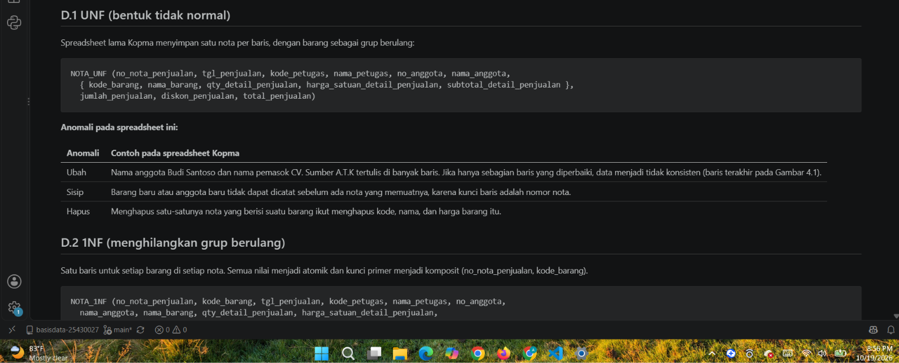
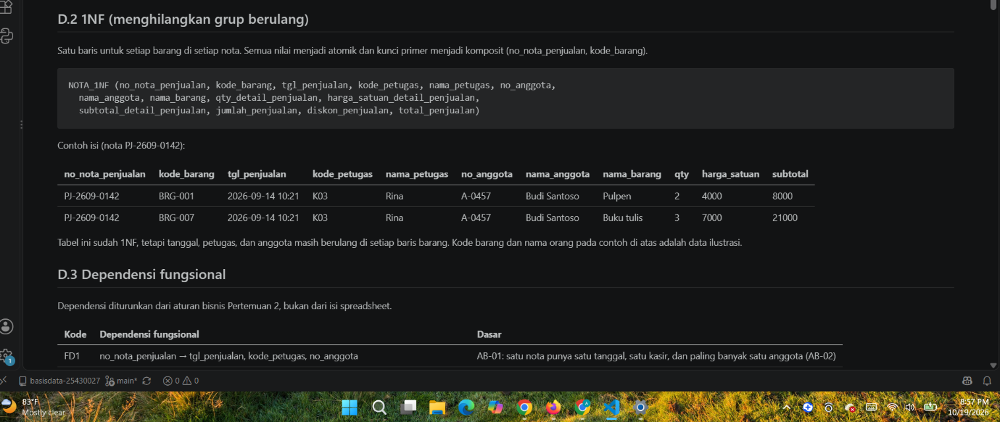
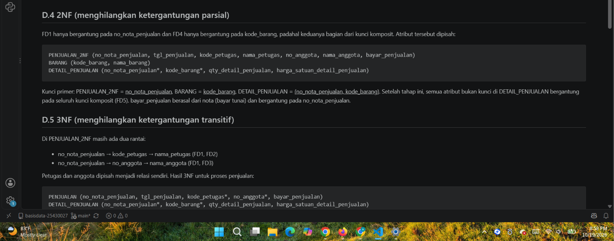
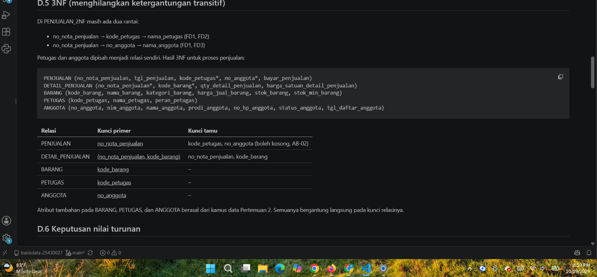
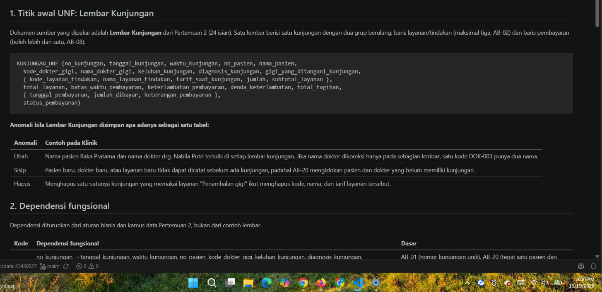
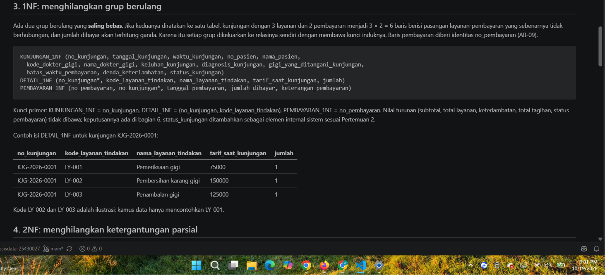
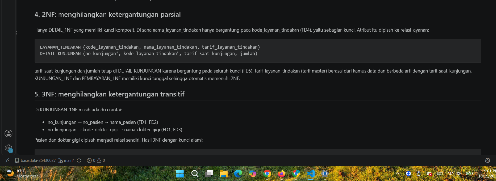
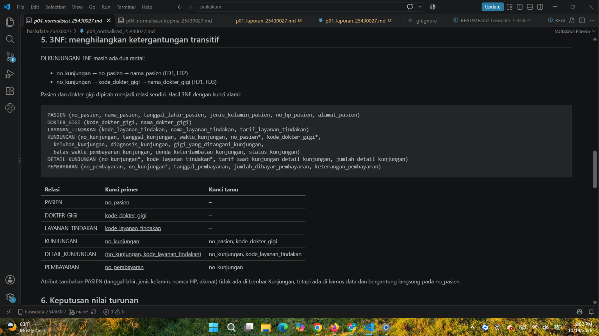

# Laporan Praktikum Basis Data - Pertemuan 4

**Nama:** Gilang Pangestu    **NPM:** 25430027    **Kelas:** A    **Tanggal:** 19 Oktober 2026

**Dosen:** Dedi Irawan, S.Kom., M.Kom.

## 1. Tujuan Praktikum

Praktikum ini melatih saya mengenali anomali ubah, sisip, dan hapus pada data yang belum dinormalisasi. Saya menuliskan dependensi fungsional berdasarkan aturan bisnis, lalu menormalisasi relasi bertahap dari UNF sampai 3NF dan memeriksa BCNF. Saya juga memutuskan nilai turunan mana yang disimpan atau dihitung, dan mendokumentasikan skema relasional akhir untuk Kopma dan proyek Klinik.

## 2. Ringkasan Dasar Teori

Data yang disimpan berulang dalam satu tabel besar menimbulkan tiga **anomali**: anomali ubah (satu fakta tertulis di banyak baris sehingga bisa tidak konsisten), anomali sisip (fakta tidak bisa dicatat sebelum ada fakta lain), dan anomali hapus (menghapus satu fakta ikut menghapus fakta lain).

**Dependensi fungsional** A → B berarti setiap nilai A selalu menentukan tepat satu nilai B. Dependensi diturunkan dari aturan bisnis, bukan dari contoh data. Contoh data hanya bisa membantah dependensi, tidak bisa membuktikannya.

**Normalisasi** dilakukan bertahap. 1NF menghilangkan grup berulang sehingga semua nilai atomik. 2NF menghilangkan atribut yang hanya bergantung pada sebagian kunci komposit. 3NF menghilangkan rantai A → B → C di dalam satu tabel. **BCNF** lebih ketat: setiap penentu harus kunci kandidat. Kunci pengganti `id_*` tidak menyelesaikan normalisasi, karena dependensi fungsional tetap diperiksa dengan kunci alami.

## 3. Hasil Langkah Percobaan

Seluruh tahapan Kopma disimpan di `p04_normalisasi_kopma_25430027.md`.

**D.1 UNF.** Spreadsheet lama Kopma menyimpan satu nota per baris dengan barang sebagai grup berulang:

```
NOTA_UNF (no_nota_penjualan, tgl_penjualan, kode_petugas, nama_petugas, no_anggota, nama_anggota,
  { kode_barang, nama_barang, qty_detail_penjualan, harga_satuan_detail_penjualan, subtotal_detail_penjualan },
  jumlah_penjualan, diskon_penjualan, total_penjualan)
```

Anomalinya: nama anggota dan pemasok tertulis di banyak baris (ubah), barang baru tidak bisa dicatat sebelum terjual (sisip), dan menghapus satu-satunya nota suatu barang ikut menghapus data barang itu (hapus).

**D.2 1NF.** Grup berulang dihilangkan: satu baris untuk setiap barang di setiap nota, dengan kunci komposit (`no_nota_penjualan`, `kode_barang`).

**D.3 Dependensi fungsional.**

| Kode | Dependensi fungsional | Dasar |
|---|---|---|
| FD1 | no_nota_penjualan → tgl_penjualan, kode_petugas, no_anggota | AB-01, AB-02 |
| FD2 | kode_petugas → nama_petugas | satu kode untuk satu petugas |
| FD3 | no_anggota → nama_anggota, nim_anggota | AB-05 |
| FD4 | kode_barang → nama_barang | satu kode untuk satu barang |
| FD5 | (no_nota_penjualan, kode_barang) → qty_detail_penjualan, harga_satuan_detail_penjualan | AB-04 |
| FD6 | qty, harga_satuan → subtotal_detail_penjualan | turunan |

kode_barang → harga_satuan_detail_penjualan **tidak** berlaku, karena menurut AB-04 harga di nota bisa berbeda dari harga barang saat ini.

**D.4–D.5 2NF dan 3NF.** FD1 dan FD4 hanya bergantung pada sebagian kunci, sehingga penjualan dan barang dipisah (2NF). Di penjualan masih ada rantai no_nota_penjualan → kode_petugas → nama_petugas dan no_nota_penjualan → no_anggota → nama_anggota, sehingga petugas dan anggota dipisah (3NF). Hasilnya: PENJUALAN, DETAIL_PENJUALAN, BARANG, PETUGAS, dan ANGGOTA.

**D.6 Nilai turunan.** subtotal, jumlah, diskon, total, dan kembali tidak disimpan di tabel operasional, karena semuanya dapat dihitung dari detail nota dan status anggota.

**D.7 Mencocokkan dengan skema kanonik.** Proses pembelian dinormalisasi dengan pola yang sama dari faktur pemasok, menghasilkan PEMBELIAN, DETAIL_PEMBELIAN, dan PEMASOK. Totalnya 8 tabel, cocok dengan Tabel 4.2. Perbedaannya hanya kunci pengganti `id_*` sebagai kunci primer, sedangkan kode alami seperti `no_nota_penjualan` menjadi kunci unik.

**D.8 BCNF.** Kedelapan tabel memenuhi BCNF. Pada `pembelian`, nomor faktur dibuat oleh pemasok, sehingga penentunya adalah pasangan (`id_pemasok`, `no_faktur_pembelian`), dan pasangan itu kunci kandidat.

**Gambar 4.1 Tahapan normalisasi Kopma**



*Gambar 4.1a UNF: nota dengan grup barang berulang.*



*Gambar 4.1b 1NF: satu baris per barang per nota.*



*Gambar 4.1c 2NF: penjualan, barang, dan detail penjualan dipisah.*



*Gambar 4.1d 3NF: petugas dan anggota dipisah dari penjualan.*

**D.9 Commit.** Berkas di-commit dengan pesan `p04: normalisasi kopma` (lihat bagian 10).

## 4. Jawaban Titik Analisis

**Titik Analisis 1**

`harga_satuan_detail_penjualan` ditempatkan pada kunci (`no_nota_penjualan`, `kode_barang`) karena harga itu adalah fakta transaksi: harga yang berlaku pada nota tertentu untuk barang tertentu (AB-04). Kode barang saja tidak menentukannya, karena barang yang sama bisa terjual dengan harga berbeda pada waktu berbeda.

Jika harga dipindah ke tabel barang, setiap kenaikan harga ikut mengubah nilai semua nota lama. Laporan omzet tahun lalu akan dihitung ulang memakai harga hari ini, sehingga angkanya berubah dan tidak lagi cocok dengan uang yang benar-benar diterima.

**Titik Analisis 2**

Keputusan "total tidak disimpan" berlaku untuk **data operasional**, yaitu data yang masih bisa diperbaiki (misalnya qty salah ketik), sehingga total harus selalu mengikuti detailnya. Tabel arsip di Buku 2 menyimpan **potret historis**, yaitu nilai yang sudah final dan tidak boleh berubah lagi walaupun aturan diskon atau data anggota kemudian berubah.

Jadi kedua keputusan tetap konsisten: data operasional mengutamakan konsistensi dengan detailnya, sedangkan arsip mengutamakan nilai yang tidak berubah.

## 5. Hasil Latihan dan Modifikasi

**E.1 Beberapa nomor telepon untuk setiap pemasok**

Menyimpan beberapa nomor dalam satu kolom (misalnya `'0725-41234, 0812-7788-9900'`) melanggar 1NF karena nilainya tidak atomik. Menambah kolom telepon1, telepon2, dan seterusnya juga grup berulang. Telepon dipindah ke relasi sendiri:

```
PEMASOK (id_pemasok, nama_pemasok, alamat_pemasok)
TELEPON_PEMASOK (id_pemasok*, telepon_pemasok, jenis_telepon_pemasok)
```

Kunci primer TELEPON_PEMASOK adalah (`id_pemasok`, `telepon_pemasok`), sehingga satu pemasok bisa punya nol atau banyak nomor tanpa duplikat.

**E.2 Pelanggaran 3NF bila nama_anggota disimpan di penjualan**

Rantai no_nota_penjualan → no_anggota → nama_anggota adalah ketergantungan transitif. Contoh: anggota A-0457 Budi Santoso tercatat di nota PJ-2609-0142, PJ-2609-0150, dan PJ-2610-0011. Jika nama hanya diperbaiki pada satu nota:

```sql
UPDATE penjualan_tidak_3nf
SET nama_anggota = 'Budi Santosa'
WHERE no_nota_penjualan = 'PJ-2609-0142';
```

anggota yang sama kini punya dua nama berbeda. Itulah anomali ubah. Pada skema 3NF, perbaikan cukup satu baris:

```sql
UPDATE anggota
SET nama_anggota = 'Budi Santosa'
WHERE no_anggota = 'A-0457';
```

Pembahasan lengkap kedua latihan ada di bagian akhir `p04_normalisasi_kopma_25430027.md`.

## 6. Tugas Mandiri: Milestone Proyek 4

Berkas: `p04_normalisasi_25430027.md`.

### 6.1 Titik awal UNF

Dokumen sumber yang dipakai adalah **Lembar Kunjungan** dari Pertemuan 2 (24 isian). Lembar ini memiliki dua grup berulang: baris layanan/tindakan (maksimal tiga, AB-02) dan baris pembayaran (boleh lebih dari satu, AB-08).

### 6.2 Dependensi fungsional dan dasar AB

| Kode | Dependensi fungsional | Dasar |
|---|---|---|
| FD1 | no_kunjungan → tanggal, waktu, no_pasien, kode_dokter_gigi, keluhan, diagnosis, gigi yang ditangani, batas waktu pembayaran, denda final, status kunjungan | AB-01, AB-20, AB-11 |
| FD2 | no_pasien → nama, tanggal lahir, jenis kelamin, no HP, alamat | AB-12 |
| FD3 | kode_dokter_gigi → nama_dokter_gigi | kamus data (DOK-NNN unik) |
| FD4 | kode_layanan_tindakan → nama, tarif master | kamus data (LY-NNN unik) |
| FD5 | (no_kunjungan, kode_layanan_tindakan) → tarif_saat_kunjungan, jumlah | AB-03, AB-02 |
| FD6 | no_pembayaran → no_kunjungan, tanggal, jumlah dibayar, keterangan | AB-09 |

Tiga dependensi yang sengaja dinyatakan **tidak** berlaku: kode layanan → tarif saat kunjungan (AB-03), no_kunjungan → no_pembayaran (AB-08), dan tanggal kunjungan → batas waktu pembayaran (aturan tujuh hari bisa berubah, sehingga batas disimpan sebagai potret).

### 6.3 Tahapan normalisasi

| Tahap | Hasil |
|---|---|
| UNF | KUNJUNGAN_UNF dengan grup layanan dan grup pembayaran |
| 1NF | KUNJUNGAN_1NF, DETAIL_1NF (kunci no_kunjungan + kode_layanan_tindakan), PEMBAYARAN_1NF (kunci no_pembayaran) |
| 2NF | nama layanan bergantung pada sebagian kunci, sehingga LAYANAN_TINDAKAN dipisah dari DETAIL_KUNJUNGAN |
| 3NF | rantai melalui no_pasien dan kode_dokter_gigi, sehingga PASIEN dan DOKTER_GIGI dipisah dari KUNJUNGAN |
| BCNF | keenam tabel lolos; setiap penentu adalah kunci kandidat |

Keputusan penting di 1NF: kedua grup berulang dipisah ke relasi masing-masing, bukan diratakan ke satu tabel. Jika diratakan, kunjungan dengan 3 layanan dan 2 pembayaran menjadi 6 baris berisi pasangan layanan-pembayaran yang tidak berhubungan, dan jumlah dibayar terhitung ganda.

**Gambar 4.2 Tahapan normalisasi Klinik**



*Gambar 4.2a UNF: Lembar Kunjungan dengan grup layanan dan grup pembayaran.*



*Gambar 4.2b 1NF: kunjungan, detail, dan pembayaran dipisah.*



*Gambar 4.2c 2NF: layanan/tindakan dipisah dari detail kunjungan.*



*Gambar 4.2d 3NF: pasien dan dokter gigi dipisah dari kunjungan.*

### 6.4 Keputusan nilai turunan

| Nilai | Keputusan | Alasan |
|---|---|---|
| subtotal, total layanan, total tagihan | Tidak disimpan | Dapat dihitung dari tarif saat kunjungan, jumlah, dan denda |
| keterlambatan | Tidak disimpan | Nilainya berubah setiap hari selama belum Lunas |
| status pembayaran | Tidak disimpan | Dihitung dari pembayaran kumulatif dan total tagihan (AB-07); bila disimpan, koreksi pembayaran (AB-16, AB-17) bisa membuat status tidak cocok |
| denda final | Disimpan | Potret denda saat Lunas (AB-11); dikosongkan bila status kembali Belum Lunas (AB-17) |
| batas waktu pembayaran | Disimpan | Potret aturan saat kunjungan dibuat; dihitung ulang hanya saat tanggal dikoreksi ketika Berjalan (AB-14) |
| tarif saat kunjungan | Disimpan | Tidak boleh ikut berubah bila tarif master berubah (AB-03) |

### 6.5 Perubahan ERD

Hasil normalisasi menghasilkan enam tabel yang sama dengan ERD Pertemuan 3: pasien, dokter_gigi, layanan_tindakan, kunjungan, detail_kunjungan, dan pembayaran, dengan kunci yang sama. **ERD tidak diubah.** Yang kini final adalah keputusan atribut turunan yang di ERD diberi tanda `/`: semuanya tetap tidak disimpan.

## 7. Pembahasan dan Kendala

Modul 4 tidak menjalankan kueri di server, sehingga tidak ada galat MariaDB. Kendala yang muncul berupa keputusan analisis.

**Kendala 1: Dua grup berulang pada Lembar Kunjungan**
- **Yang terlihat:** Lembar Kunjungan punya grup layanan dan grup pembayaran sekaligus, berbeda dengan nota Kopma yang hanya punya grup barang.
- **Penyebab:** Kedua grup saling bebas. Satu layanan tidak terkait dengan satu pembayaran tertentu.
- **Cara mengatasi:** Pada tahap 1NF, setiap grup dikeluarkan ke relasinya sendiri dengan membawa no_kunjungan, bukan diratakan menjadi satu tabel dengan kunci gabungan.

**Kendala 2: Apakah batas waktu pembayaran melanggar 3NF?**
- **Yang terlihat:** Batas waktu tampak bisa dihitung dari tanggal kunjungan (+7 hari), sehingga sempat terlihat seperti rantai no_kunjungan → tanggal_kunjungan → batas_waktu_pembayaran.
- **Cara membaca:** Dependensi harus berasal dari aturan bisnis yang berlaku sepanjang waktu. Pertemuan 2 sudah memutuskan batas disimpan agar kunjungan lama tidak berubah bila aturan tujuh hari diganti.
- **Cara mengatasi:** Dependensi tanggal → batas dinyatakan tidak berlaku, dan alasannya ditulis di daftar FD.

**Kendala 3: Godaan menyimpulkan dependensi dari contoh data**
- **Yang terlihat:** Pada contoh, tarif pemeriksaan gigi selalu Rp75.000, sehingga seolah kode_layanan → tarif_saat_kunjungan.
- **Cara mengatasi:** Kembali ke AB-03. Tarif pada kunjungan lama tidak berubah walaupun tarif master berubah, jadi dependensi itu tidak berlaku (Troubleshooting Masalah 1).

## 8. Kesimpulan

Normalisasi menghilangkan anomali dengan memisahkan fakta yang bergantung pada kunci berbeda, dan setiap pemisahan harus dapat dijelaskan dengan dependensi fungsional yang berasal dari aturan bisnis. Hasil normalisasi Kopma cocok dengan skema kanonik delapan tabel, dan hasil normalisasi Klinik cocok dengan ERD Pertemuan 3. Saya juga belajar membedakan nilai turunan yang cukup dihitung dari nilai potret, seperti tarif saat kunjungan dan denda final, yang justru harus disimpan.

## 9. Pernyataan Penggunaan AI

Saya menggunakan Claude (Anthropic) dalam pengerjaan Modul 4, dengan rincian berikut:

- **Pembelajaran:** Claude membaca modul dan repositori saya, lalu menjelaskan langkah pertama (UNF dan anomali).
- **Dokumen normalisasi:** Claude menyusun `p04_normalisasi_kopma_25430027.md` (langkah D.1–D.8, Titik Analisis, dan Latihan E.1–E.2) serta `p04_normalisasi_25430027.md` (Milestone Proyek 4), berdasarkan dokumen kebutuhan data Pertemuan 2 dan ERD Pertemuan 3 saya. Saya memeriksa isinya sebelum commit.
- **Laporan:** Claude menyusun draf laporan ini.

Tangkapan layar serta seluruh perintah Git saya kerjakan sendiri.

## 10. Bukti Git

- Repositori: https://github.com/GilangPangestu098/basisdata-25430027

| Hash Commit | Pesan Commit |
| `471a979` | p04: laporan pertemuan 4 |
| `0ad6ea2` | p04: normalisasi kopma |
| `8c4f2a9` | p04: normalisasi proyek klinik |

> **[ISI HASH]** Tambahkan baris hash commit laporan ini setelah di-commit.

## Checklist

**Tabel 4.3 Checklist khusus laporan Pertemuan 4**

| Status | Jenis | Yang harus ada |
| :----: | :---- | :---- |
| ☑️ | Berkas wajib | `p04_normalisasi_<NIM>.md` (proyek) |
| ☑️ | Bukti tangkapan layar | Tabel tahapan UNF → 1NF → 2NF → 3NF |
| ☑️ | Analisis wajib | Daftar dependensi fungsional; keputusan menyimpan atau menghitung nilai turunan beserta alasannya |

### Tabel P.13 Checklist umum laporan praktikum

| Status | Butir | Yang harus ada |
| :----: | :---- | :---- |
| ☑️ | Identitas | Nama, NIM, kelas, pertemuan ke-N, tanggal pelaksanaan, nama asisten/dosen |
| ☑️ | Tujuan | Tujuan praktikum ditulis ulang dengan bahasa sendiri (maksimal 5 baris) |
| ☑️ | Ringkasan teori | Pemahaman sendiri atas Dasar Teori, maksimal setengah halaman, tanpa menyalin buku |
| ☑️ | Langkah percobaan (D) | Tangkapan layar hasil langkah kunci sesuai checklist khusus, masing-masing diberi keterangan singkat |
| ☑️ | Titik Analisis | Semua Titik Analisis dijawab lengkap dengan alasan, bukan sekadar ya/tidak |
| ☑️ | Latihan (E) | Skrip/dokumen hasil latihan beserta bukti berjalan |
| ☑️ | Tugas Mandiri (F) | Milestone proyek pertemuan ini: berkas, bukti, dan penjelasan keputusan desain |
| ☑️ | Pembahasan dan kendala | Galat yang ditemui, cara membacanya, dan cara mengatasinya |
| ☑️ | Kesimpulan | Dua sampai empat kalimat dengan bahasa sendiri |
| ☑️ | Pernyataan Penggunaan AI | Alat yang dipakai, untuk apa, bagian mana; tulis "tidak menggunakan" bila tidak memakai |
| ☑️ | Bukti Git | Tautan repositori dan kode commit (hash) pertemuan ini dengan pesan pNN: ... |
| ☑️ | Keaslian | Setiap tangkapan layar memperlihatkan akun ber-NIM dan jam sistem; nama objek memuat NIM/inisial |