# Laporan Praktikum Basis Data - Pertemuan 5

**Nama:** Gilang Pangestu    **NPM:** 25430027    **Kelas:** A    **Tanggal:** 20 Oktober 2026

**Dosen:** Dedi Irawan, S.Kom., M.Kom.

## 1. Tujuan Praktikum

Praktikum ini melatih saya mengubah skema relasional 3NF menjadi perintah `CREATE TABLE` dengan tipe data yang tepat. Saya memasang constraint PRIMARY KEY, FOREIGN KEY, UNIQUE, NOT NULL, DEFAULT, dan CHECK sesuai aturan bisnis, lalu mengubah dan menghapus struktur dengan `ALTER TABLE` dan `DROP TABLE` dalam urutan yang benar. Terakhir, saya membuktikan bahwa constraint benar-benar menolak data yang salah dan membandingkan desain fisik dengan ERD.

## 2. Ringkasan Dasar Teori

**DDL** adalah bagian SQL untuk membuat, mengubah, dan menghapus struktur. Memilih tipe data adalah keputusan desain: tipe yang terlalu besar membuang ruang, tipe yang terlalu kecil menolak data yang sah. Kode berformat tetap cocok memakai `CHAR(n)`, uang memakai `DECIMAL(12,2)` karena `FLOAT` bisa membulatkan, dan pilihan yang terbatas memakai `ENUM`.

**Constraint** memindahkan aturan bisnis dari kedisiplinan pengguna menjadi jaminan server. PRIMARY KEY mengenali setiap baris, FOREIGN KEY menjaga agar rujukan selalu ke baris induk yang ada, UNIQUE mencegah kode kembar, dan CHECK (ditegakkan sejak MariaDB 10.2) menolak nilai di luar aturan, misalnya stok negatif. Namun constraint hanya melihat satu baris atau satu rujukan. Aturan yang melibatkan banyak baris, seperti "minimal satu barang per nota", tidak bisa dijaga CHECK.

**Urutan** juga penting. Tabel induk dibuat lebih dulu daripada tabel anak dan dihapus paling akhir. Karena itu, skrip yang dapat dijalankan ulang diawali `DROP TABLE IF EXISTS` dari anak ke induk. Tabel tidak diberi `CHARACTER SET` sendiri sehingga mewarisi `utf8mb4_unicode_ci` dari basis data.

## 3. Hasil Langkah Percobaan

Seluruh langkah Kopma saya jalankan di CMD XAMPP (MariaDB 10.4.32) sebagai `mhs_027` pada basis data `kopma_027`. Skrip struktur ada di `p05_ddl_kopma_25430027.sql`, sedangkan blok perintah uji ada di `p05_uji_kopma_25430027.sql`. Setiap tangkapan layar memuat hasil `SELECT CURRENT_USER(), NOW();` agar akun dan jam terlihat.

**D.1 Membuat tabel induk.** Skrip diawali `USE kopma_027;`, lalu membuat empat tabel master tanpa kunci tamu: `petugas`, `anggota`, `barang`, dan `pemasok`. `nim_anggota` dan `no_anggota` masing-masing diberi UNIQUE untuk AB-05. Semua constraint saya beri nama dengan pola `pk_`, `fk_`, `uq_`, `ck_` ditambah nama tabel, dan setiap constraint yang menjaga aturan bisnis diberi komentar AB-xx.

**D.2 Membuat tabel dengan kunci tamu.** Tabel transaksi dibuat sesudah induknya: `penjualan`, `detail_penjualan`, `pembelian`, `detail_pembelian`. Tipe kolom kunci tamu sama persis dengan kolom yang dirujuk (misalnya `id_petugas SMALLINT` di `penjualan` merujuk `petugas.id_petugas SMALLINT`), sehingga tidak muncul ERROR 1005 errno 150. Hasilnya delapan tabel.

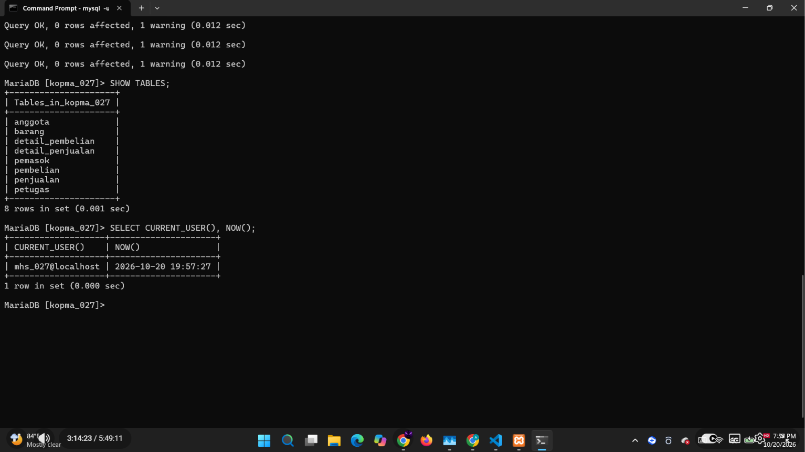

*Gambar 5.1 `SHOW TABLES` setelah skrip DDL Kopma dijalankan: delapan tabel terbentuk.*

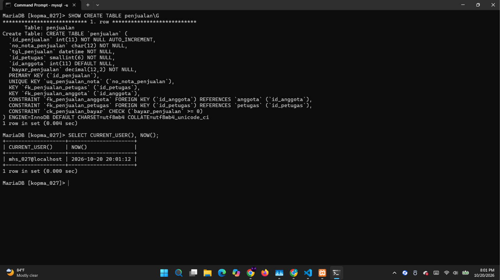

*Gambar 5.2 `SHOW CREATE TABLE penjualan`: kunci unik `uq_penjualan_nota`, kunci tamu `fk_penjualan_petugas` dan `fk_penjualan_anggota`, serta `ck_penjualan_bayar`.*

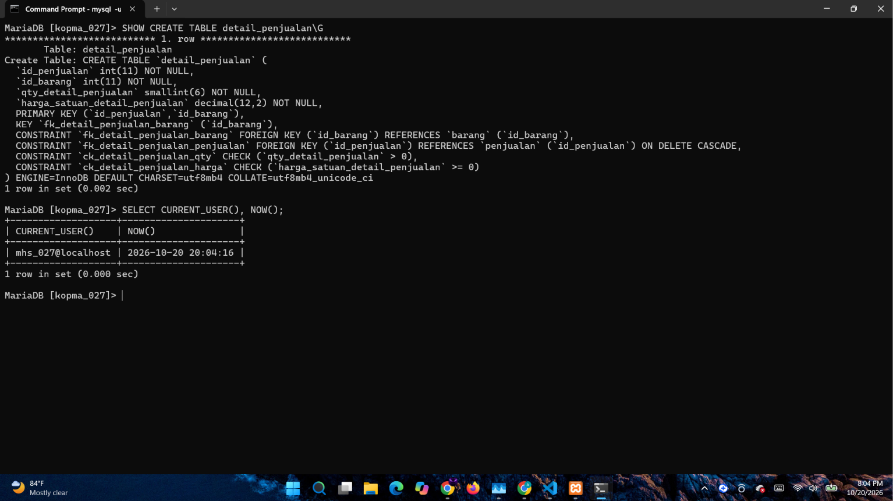

*Gambar 5.3 `SHOW CREATE TABLE detail_penjualan`: kunci primer komposit, `ON DELETE CASCADE` ke penjualan, dan CHECK qty lebih dari nol.*

**D.3 Membuktikan constraint bekerja.** Saya mengisi dua petugas (K01, K03) dan dua barang (ATK-001, MKN-001), lalu menjalankan tiga perintah yang melanggar aturan. Ketiganya ditolak server.

```sql
INSERT INTO penjualan (no_nota_penjualan, tgl_penjualan, id_petugas, id_anggota, bayar_penjualan)
VALUES ('PJ-2609-0199', NOW(), 99, NULL, 5000);   -- petugas 99 tidak ada
-- ERROR 1452 (23000): Cannot add or update a child row: a foreign key constraint fails
-- (`kopma_027`.`penjualan`, CONSTRAINT `fk_penjualan_petugas` ...)

UPDATE barang SET stok_barang = -1 WHERE kode_barang = 'ATK-001';   -- melanggar AB-03
-- ERROR 4025 (23000): CONSTRAINT `ck_barang_stok` failed for `kopma_027`.`barang`

INSERT INTO barang (kode_barang, nama_barang, kategori_barang, harga_jual_barang)
VALUES ('ATK-001', 'Duplikat', 'ATK', 1000);   -- kode kembar
-- ERROR 1062 (23000): Duplicate entry 'ATK-001' for key 'uq_barang_kode'
```

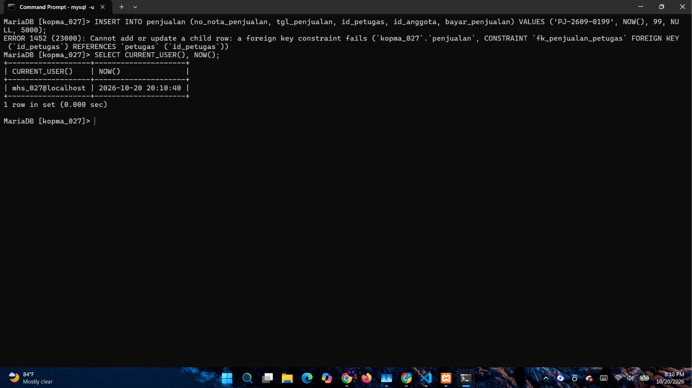

*Gambar 5.4 Nota dengan petugas 99 ditolak ERROR 1452 oleh `fk_penjualan_petugas`.*

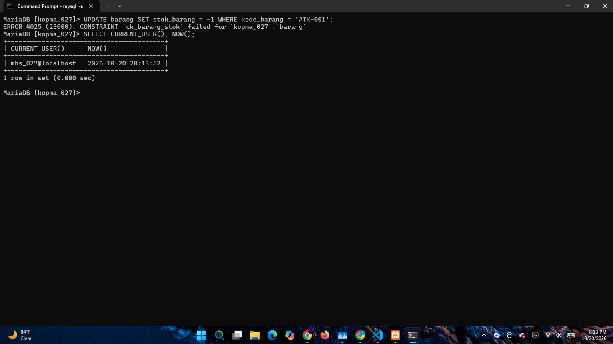

*Gambar 5.5 Stok -1 ditolak ERROR 4025 oleh `ck_barang_stok` (AB-03).*

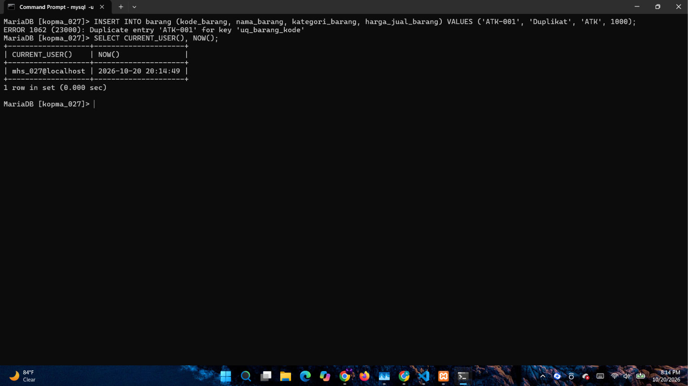

*Gambar 5.6 Kode barang kembar ATK-001 ditolak ERROR 1062 oleh `uq_barang_kode`.*

**D.4 Mengubah struktur dan membandingkan dengan ERD.** Kolom `tgl_kedaluwarsa` ditambahkan dengan `ALTER TABLE ... ADD COLUMN ... AFTER stok_min_barang`, diperiksa dengan `DESCRIBE barang`, lalu dihapus kembali dengan `DROP COLUMN` sesuai modul. Tabel tidak perlu dibuat ulang dan data di dalamnya tetap ada.

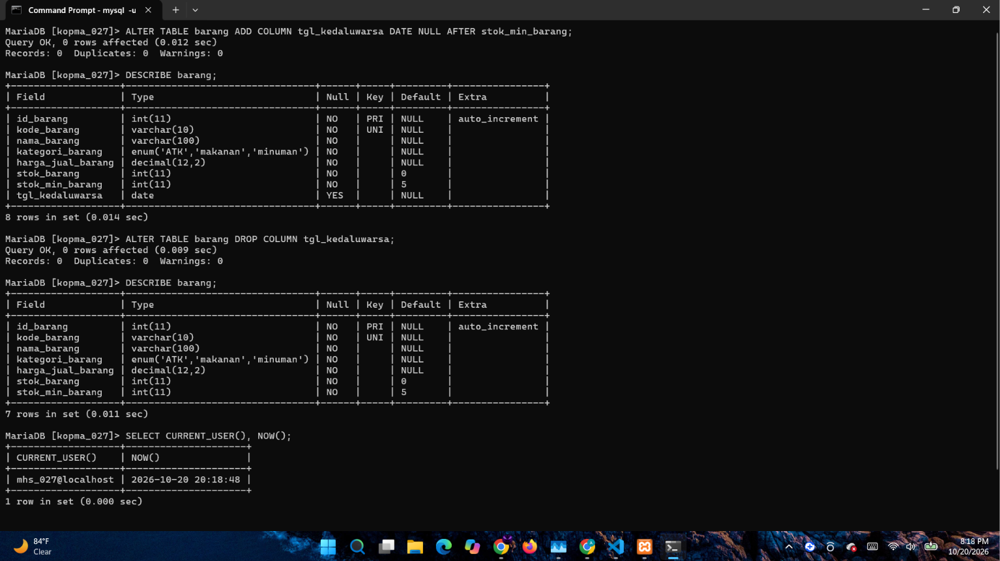

*Gambar 5.7 Kolom `tgl_kedaluwarsa` muncul di `DESCRIBE barang` setelah ADD COLUMN, lalu hilang lagi setelah DROP COLUMN.*

ERD fisik Kopma adalah ERD pada Gambar 3.2 Modul 3. Saya mencocokkannya kolom demi kolom dengan skrip DDL. Di phpMyAdmin Designer (`kopma_027`), saya menyusun delapan tabel agar mirip ERD Pertemuan 3.

| Aspek yang dibandingkan | ERD Pertemuan 3 | Designer (desain fisik) | Hasil |
|---|---|---|---|
| Jumlah dan nama tabel | 8 tabel | 8 tabel dengan nama sama | Sesuai |
| Kunci primer | id_* dan komposit pada dua tabel detail | Sama | Sesuai |
| Relasi (garis kunci tamu) | 7 relasi | 7 garis kunci tamu dengan arah yang sama | Sesuai |
| Kolom per tabel | Sesuai kamus data | Sama, termasuk kolom opsional `id_anggota` | Sesuai |

Tidak ada perbedaan antara desain fisik dan ERD.

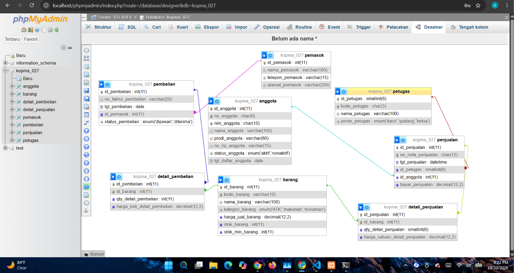

*Gambar 5.8 phpMyAdmin Designer `kopma_027` yang disusun mengikuti ERD Pertemuan 3; tidak ada perbedaan.*

Skrip sudah diawali blok `DROP TABLE IF EXISTS` dari `detail_pembelian` sampai `petugas`. Saat dijalankan ulang, semuanya berhasil tanpa ERROR 1050 dan `SHOW TABLES` tetap menampilkan delapan tabel.

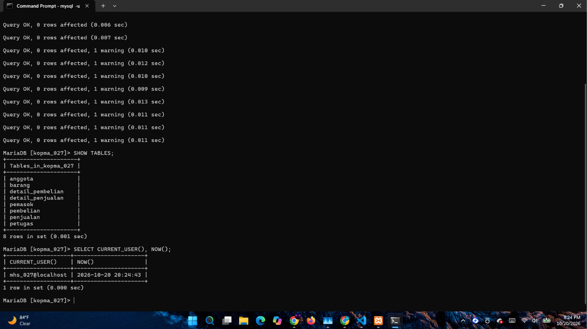

*Gambar 5.9 Skrip DDL Kopma dijalankan ulang tanpa galat; delapan tabel terbentuk kembali.*

**D.5 Membaca ERD fisik.** Delapan tabel Kopma terdiri atas empat tabel master (petugas, anggota, barang, pemasok), dua kepala transaksi (penjualan, pembelian), dan dua detail transaksi (detail_penjualan, detail_pembelian). Penjualan dan pembelian mirip strukturnya tetapi arusnya berlawanan: penjualan mengurangi stok dan memakai `DATETIME`, sedangkan pembelian menambah stok saat statusnya `diterima` dan cukup memakai `DATE`. Total belanja tidak disimpan di penjualan karena dihitung dari detail (keputusan Modul 4).

**Commit.** Skrip Kopma di-commit dengan pesan `p05: ddl kopma` (lihat bagian 10).

## 4. Jawaban Titik Analisis

**Titik Analisis 1**

Di skrip saya, kedua kunci tamu itu bernama `fk_detail_penjualan_penjualan` dan `fk_detail_penjualan_barang` mengikuti pola nama `fk_` + tabel. `fk_detail_penjualan_penjualan` memakai `ON DELETE CASCADE` karena baris detail adalah bagian dari notanya. Jika nota dibatalkan, rinciannya tidak punya arti lagi tanpa kepala nota, sehingga wajar ikut terhapus.

`fk_detail_penjualan_barang` tidak memakai CASCADE (bawaan RESTRICT) karena barang adalah data master yang dirujuk oleh riwayat transaksi. Jika barang boleh dihapus beserta seluruh detailnya, baris penjualan lama ikut hilang. Laporan omzet, barang terlaris, dan belanja anggota periode lalu akan berubah, total nota lama tidak lagi sama dengan uang yang benar-benar diterima, dan bisa tersisa nota tanpa satu pun baris barang (melanggar AB-01). Barang yang tidak dijual lagi sebaiknya dinonaktifkan, bukan dihapus.

**Titik Analisis 2**

| Kode galat | Constraint | Aturan bisnis yang dilindungi |
|---|---|---|
| 1452 | `fk_penjualan_petugas` | Permintaan pengurus "jangan ada nota tanpa kasir": setiap nota harus dibuat oleh petugas yang benar-benar ada. Pola yang sama (`fk_penjualan_anggota`) menjaga AB-02: jika nota memakai anggota, anggota itu harus terdaftar. |
| 4025 | `ck_barang_stok` | AB-03 bagian pertama: stok barang tidak boleh negatif. |
| 1062 | `uq_barang_kode` | Kode barang unik sesuai kamus data. Mekanisme yang sama menjaga AB-01 (`uq_penjualan_nota`, nomor nota unik) dan AB-05 (`uq_anggota_nim`, `uq_anggota_no`). |

Aturan Kopma yang belum dapat dijaga constraint apa pun:

- **AB-01 bagian kedua** (minimal satu baris barang per nota): melibatkan baris di tabel lain, jadi CHECK tidak bisa melihatnya. Diselesaikan dengan transaksi di Modul 14.
- **AB-02 bagian diskon** (hanya anggota aktif yang mendapat diskon 5%): FK hanya memastikan anggota ada, bukan statusnya aktif. Diskon dihitung saat kueri.
- **AB-03 bagian kedua** (penjualan ditolak bila qty melebihi stok): membandingkan `detail_penjualan` dengan `barang`, dua tabel berbeda.
- **AB-04** (harga disalin saat transaksi): kolom `harga_satuan_detail_penjualan` sudah tersedia dan wajib diisi, tetapi server tidak bisa memastikan nilainya benar-benar disalin dari harga jual saat itu.
- **AB-06** (pesanan pembelian dibuat bila stok di bawah minimum): ini proses, bukan batasan nilai. Struktur hanya menyediakan `stok_min_barang` dan `status_pembelian`.

**Titik Analisis 3**

`DROP TABLE` harus dimulai dari tabel anak (`detail_pembelian`, `detail_penjualan`) karena tabel anak memegang kunci tamu ke induknya. Selama masih ada tabel yang merujuk `petugas`, server menolak menghapus `petugas` agar tidak ada rujukan yang menggantung. Urutan yang benar adalah kebalikan urutan pembuatan: detail_pembelian, detail_penjualan, pembelian, penjualan, pemasok, barang, anggota, petugas.

Saya mencobanya dengan urutan terbalik, yaitu menghapus `petugas` saat `penjualan` masih ada:

```sql
DROP TABLE petugas;
-- ERROR 1451 (23000): Cannot delete or update a parent row: a foreign key constraint fails
SHOW TABLES;   -- petugas masih ada
```

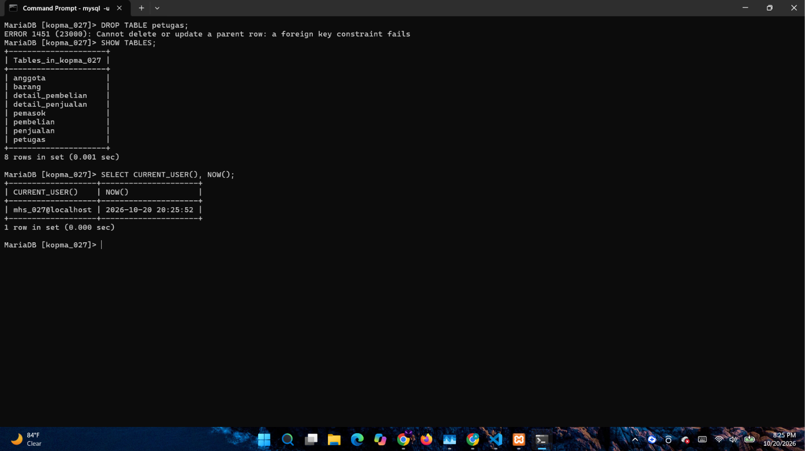

*Gambar 5.10 `DROP TABLE petugas` sebelum tabel anaknya ditolak ERROR 1451; `petugas` tetap ada di `SHOW TABLES`.*

## 5. Hasil Latihan dan Modifikasi

**E.1 CHECK untuk stok_min_barang**

```sql
ALTER TABLE barang
  ADD CONSTRAINT ck_barang_stok_min CHECK (stok_min_barang >= 0);
INSERT INTO barang (kode_barang, nama_barang, kategori_barang, harga_jual_barang, stok_min_barang)
VALUES ('ATK-002', 'Penggaris', 'ATK', 3000, -1);
-- ERROR 4025 (23000): CONSTRAINT `ck_barang_stok_min` failed for `kopma_027`.`barang`
```

Batas minimum negatif tidak masuk akal untuk AB-06, karena stok tidak akan pernah "kurang dari" batas negatif sehingga pesanan pembelian tidak pernah terpicu.

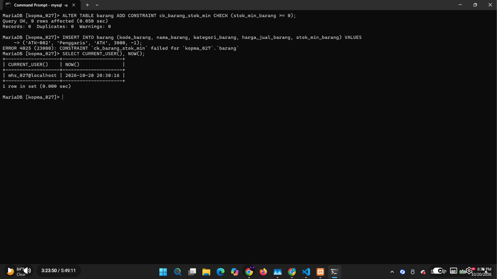

*Gambar 5.11 Constraint `ck_barang_stok_min` ditambahkan, lalu barang dengan `stok_min_barang = -1` ditolak ERROR 4025.*

**E.2 fk_penjualan_anggota dengan ON DELETE SET NULL**

```sql
ALTER TABLE penjualan DROP FOREIGN KEY fk_penjualan_anggota;
ALTER TABLE penjualan
  ADD CONSTRAINT fk_penjualan_anggota FOREIGN KEY (id_anggota)
  REFERENCES anggota (id_anggota) ON DELETE SET NULL;
SHOW CREATE TABLE penjualan\G
```

Untuk membuktikannya, saya membuat anggota A-0457 dan nota PJ-2609-0142 atas nama anggota itu, lalu menghapus anggotanya. Nota tetap ada, dan `id_anggota` berubah menjadi NULL.

```sql
DELETE FROM anggota WHERE no_anggota = 'A-0457';
SELECT no_nota_penjualan, id_anggota FROM penjualan;
-- PJ-2609-0142 | NULL
```

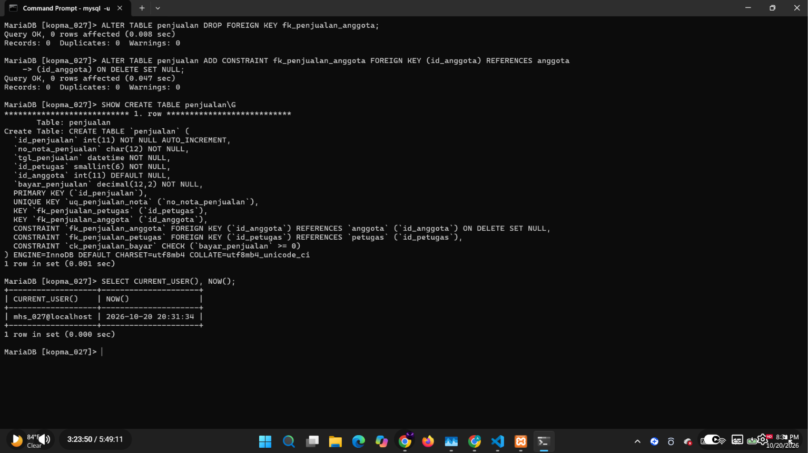

*Gambar 5.12 `SHOW CREATE TABLE penjualan` memperlihatkan `fk_penjualan_anggota ... ON DELETE SET NULL`.*

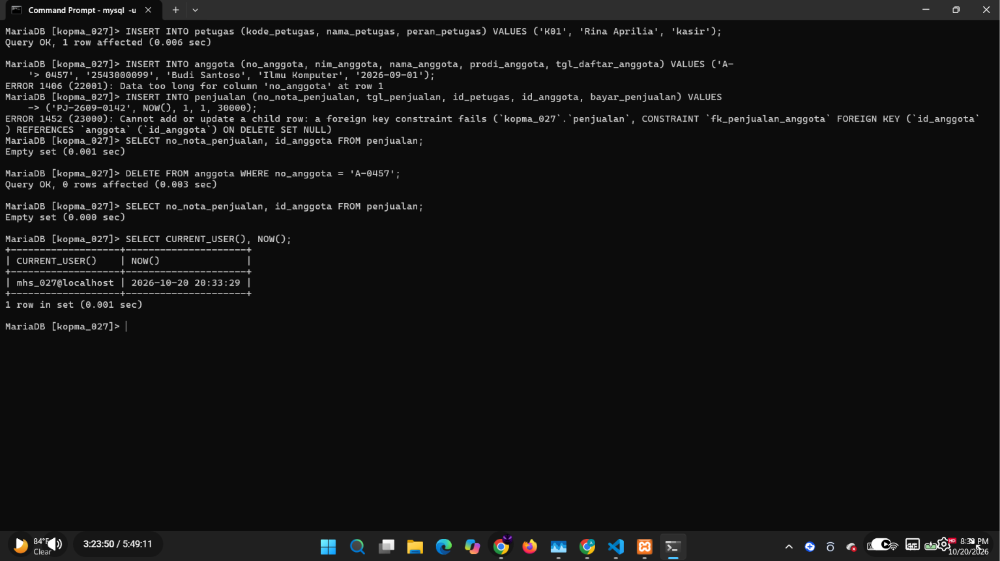

*Gambar 5.13 Setelah anggota A-0457 dihapus, nota PJ-2609-0142 tetap ada dengan `id_anggota` NULL.*

**Diskusi AB-02 dan UU PDP.** Dari sisi struktur, SET NULL tidak melanggar AB-02 karena `id_anggota` memang boleh NULL untuk pembeli umum. Namun maknanya berubah: nota yang dulu mendapat diskon 5% sekarang terlihat seperti nota pembeli umum. Diskon tidak disimpan (dihitung dari status anggota), jadi total nota lama akan dihitung ulang tanpa diskon dan tidak lagi cocok dengan uang yang diterima. Dari sisi UU PDP, SET NULL membantu memenuhi hak penghapusan data pribadi karena identitas anggota hilang tetapi catatan keuangan tetap ada.

Menurut saya, pilihan yang lebih aman untuk Kopma adalah tetap memakai RESTRICT. Anggota yang keluar cukup diubah statusnya menjadi `nonaktif`, dan bila ia meminta datanya dihapus, kolom pribadinya (`no_hp_anggota`, nama) dianonimkan tanpa menghapus barisnya. Karena itu, setelah latihan saya menjalankan ulang skrip DDL sehingga struktur final kembali ke versi modul (tanpa SET NULL dan tanpa `ck_barang_stok_min`).

## 6. Tugas Mandiri: Milestone Proyek 5

Berkas: `p05_ddl_25430027.sql` (struktur), dijalankan sebagai `dev_027` pada `klinik_027`. ERD fisik: `p05_erd_fisik_25430027.png` beserta sumbernya `p05_erd_fisik_25430027.drawio`.

### 6.1 Struktur dan bukti berjalan

Skrip membuat enam tabel sesuai skema relasional akhir Modul 4: `pasien`, `dokter_gigi`, `layanan_tindakan`, `kunjungan`, `detail_kunjungan`, dan `pembayaran`. Setiap tabel punya kunci primer, setiap relasi ERD menjadi kunci tamu, dan skrip diawali `DROP TABLE IF EXISTS` dari anak ke induk.

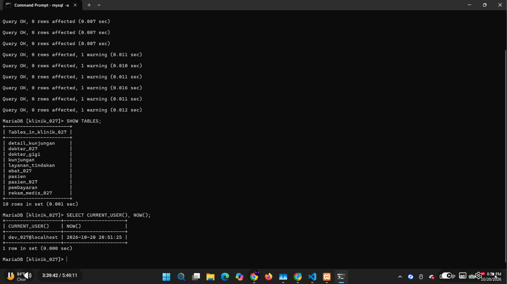

*Gambar 5.14 `SHOW TABLES` di `klinik_027` setelah skrip DDL proyek dijalankan: enam tabel terbentuk.*

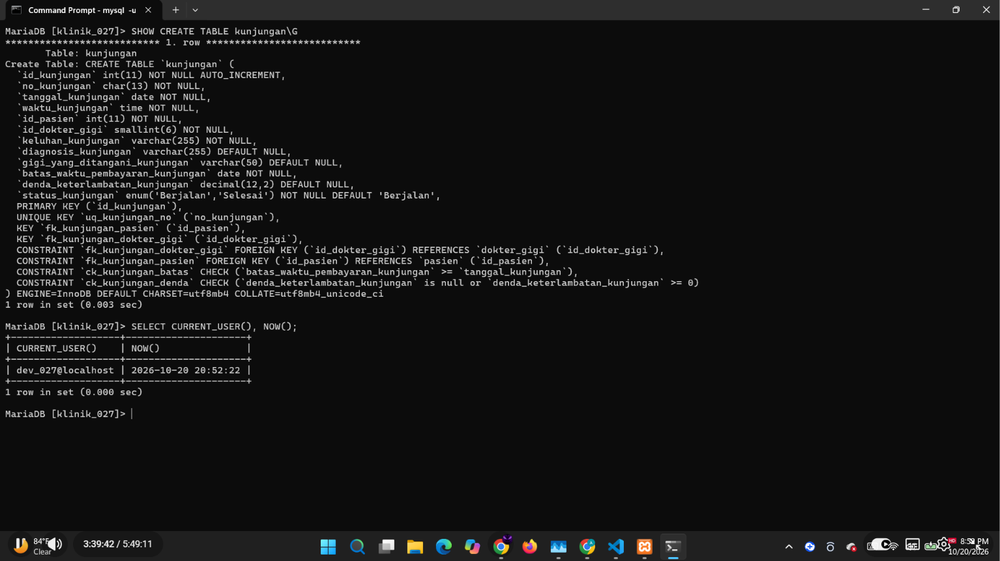

*Gambar 5.15 `SHOW CREATE TABLE kunjungan`: `uq_kunjungan_no`, dua kunci tamu ke pasien dan dokter gigi, serta CHECK batas waktu dan denda.*

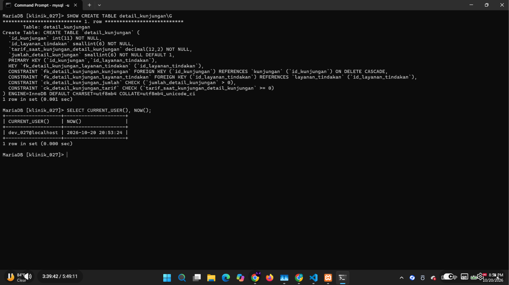

*Gambar 5.16 `SHOW CREATE TABLE detail_kunjungan`: kunci primer komposit, `ON DELETE CASCADE` ke kunjungan, dan CHECK jumlah lebih dari nol.*

Uji pelanggaran constraint pada proyek:

```sql
-- pasien 99 tidak ada (AB-20)
-- ERROR 1452 (23000): Cannot add or update a child row: a foreign key constraint fails
-- (`klinik_027`.`kunjungan`, CONSTRAINT `fk_kunjungan_pasien` ...)

-- nomor pasien kembar (AB-12)
-- ERROR 1062 (23000): Duplicate entry 'PSN-0001' for key 'uq_pasien_no'

-- jumlah layanan 0 (AB-02)
-- ERROR 4025 (23000): CONSTRAINT `ck_detail_kunjungan_jumlah` failed for `klinik_027`.`detail_kunjungan`
```

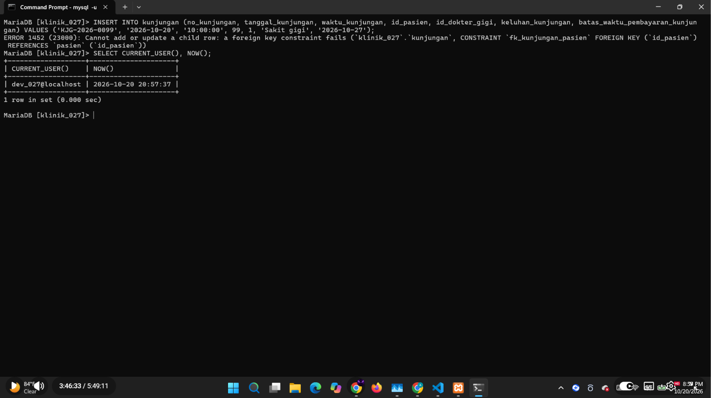

*Gambar 5.17 Kunjungan dengan pasien 99 ditolak ERROR 1452 oleh `fk_kunjungan_pasien` (AB-20).*

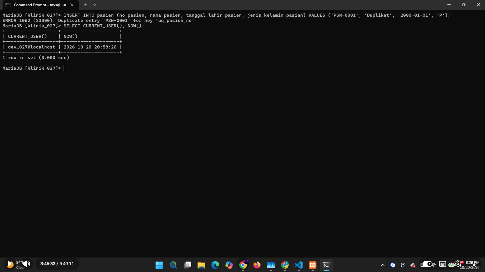

*Gambar 5.18 Nomor pasien kembar PSN-0001 ditolak ERROR 1062 oleh `uq_pasien_no` (AB-12).*

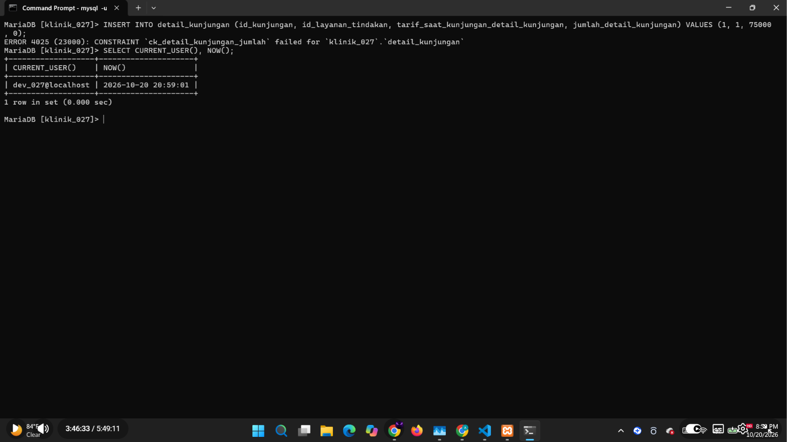

*Gambar 5.19 Detail kunjungan dengan jumlah 0 ditolak ERROR 4025 oleh `ck_detail_kunjungan_jumlah` (AB-02).*

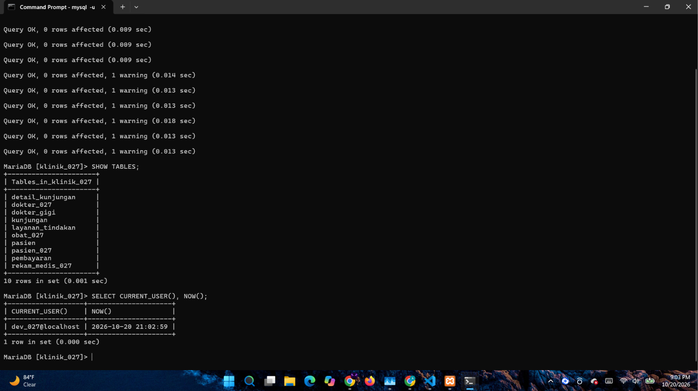

*Gambar 5.20 Skrip DDL proyek dijalankan ulang tanpa ERROR 1050; enam tabel terbentuk kembali.*

### 6.2 Pemetaan tipe data

| Atribut konseptual | Kolom | Tipe MariaDB | Alasan |
|---|---|---|---|
| Kunci pengganti pasien, kunjungan, pembayaran | id_pasien, id_kunjungan, id_pembayaran | INT AUTO_INCREMENT | Jumlahnya terus bertambah, perlu rentang besar |
| Kunci pengganti dokter dan layanan | id_dokter_gigi, id_layanan_tindakan | SMALLINT AUTO_INCREMENT | Jumlah dokter dan layanan klinik kecil |
| Nomor pasien | no_pasien | VARCHAR(12) | Kode identitas, bukan angka hitung; disiapkan sedikit lebih panjang dari PSN-0001 |
| Kode dokter gigi | kode_dokter_gigi | CHAR(7) | Format tetap DOK-NNN |
| Kode layanan/tindakan | kode_layanan_tindakan | CHAR(6) | Format tetap LY-NNN |
| Nomor kunjungan | no_kunjungan | CHAR(13) | Format tetap KJG-YYYY-NNNN |
| Nomor pembayaran | no_pembayaran | VARCHAR(15) | Kode dokumen, panjang bisa sedikit berbeda |
| Nama pasien, dokter, layanan | nama_* | VARCHAR(100) | Panjang bervariasi |
| Tanggal lahir, tanggal kunjungan, batas waktu, tanggal pembayaran | tanggal_*, batas_waktu_pembayaran_kunjungan | DATE | Cukup tanggal tanpa jam |
| Waktu kunjungan | waktu_kunjungan | TIME | Jam kunjungan dicatat terpisah dari tanggal sesuai Lembar Kunjungan |
| Jenis kelamin | jenis_kelamin_pasien | ENUM('L','P') | Nilai terbatas dan diketahui |
| Status kunjungan | status_kunjungan | ENUM('Berjalan','Selesai') DEFAULT 'Berjalan' | Dua tahap alur kunjungan (AB-14, AB-15); kunjungan baru selalu Berjalan |
| No HP dan alamat pasien | no_hp_pasien, alamat_pasien | VARCHAR(15), VARCHAR(200), NULL | Nomor HP bisa diawali 0 dan bertanda +, jadi bukan angka; data pribadi boleh kosong |
| Keluhan, diagnosis, gigi yang ditangani | keluhan_kunjungan, diagnosis_kunjungan, gigi_yang_ditangani_kunjungan | VARCHAR(255), VARCHAR(255) NULL, VARCHAR(50) NULL | Teks bebas; diagnosis dan gigi baru diisi setelah pemeriksaan |
| Tarif master, tarif saat kunjungan, denda, jumlah dibayar | tarif_*, denda_keterlambatan_kunjungan, jumlah_dibayar_pembayaran | DECIMAL(12,2) | Uang wajib tepat, tidak boleh ada galat pembulatan |
| Jumlah layanan per baris | jumlah_detail_kunjungan | SMALLINT DEFAULT 1 | Bilangan bulat kecil; umumnya satu unit |
| Keterangan pembayaran | keterangan_pembayaran | VARCHAR(100) NULL | Catatan opsional |

Nilai turunan (subtotal, total layanan, keterlambatan, total tagihan, status pembayaran) tidak dibuat kolom, sesuai keputusan Modul 4.

### 6.3 Kaitan constraint dengan AB-xx

| Constraint | Tabel | Aturan yang dijaga |
|---|---|---|
| `uq_kunjungan_no` | kunjungan | AB-01: nomor kunjungan unik |
| `ck_detail_kunjungan_jumlah` (jumlah > 0) | detail_kunjungan | AB-02: setiap baris layanan minimal satu unit |
| `ck_detail_kunjungan_tarif` (tarif >= 0), kolom NOT NULL | detail_kunjungan | AB-03: tarif saat kunjungan disimpan per baris |
| `ck_kunjungan_batas` (batas >= tanggal) | kunjungan | AB-04: batas waktu pembayaran tidak mungkin sebelum tanggal kunjungan |
| `ck_kunjungan_denda` (NULL atau >= 0) | kunjungan | AB-05, AB-11: denda final tidak negatif; NULL bila belum Lunas (AB-17) |
| `fk_pembayaran_kunjungan`, kolom `id_kunjungan` NOT NULL tanpa UNIQUE | pembayaran | AB-09: tepat satu kunjungan per pembayaran; AB-08: satu kunjungan boleh banyak pembayaran |
| `uq_pembayaran_no` | pembayaran | AB-09: nomor pembayaran unik |
| `ck_pembayaran_jumlah` (> 0) | pembayaran | Pembayaran nol atau negatif tidak bermakna |
| `uq_pasien_no` | pasien | AB-12: nomor pasien unik |
| `status_kunjungan` ENUM DEFAULT 'Berjalan' | kunjungan | AB-14, AB-15: tahap Berjalan dan Selesai |
| `fk_kunjungan_pasien`, `fk_kunjungan_dokter_gigi` (NOT NULL) | kunjungan | AB-20: setiap kunjungan punya tepat satu pasien dan satu dokter gigi |
| Tabel pasien dan dokter_gigi berdiri sendiri | pasien, dokter_gigi | AB-20: pasien dan dokter boleh dicatat sebelum punya kunjungan |
| `uq_dokter_gigi_kode`, `uq_layanan_tindakan_kode`, `ck_layanan_tindakan_tarif` | dokter_gigi, layanan_tindakan | Kamus data: kode DOK-NNN dan LY-NNN unik, tarif tidak negatif |

**Aksi ON DELETE.** `fk_detail_kunjungan_kunjungan` memakai CASCADE karena detail adalah bagian dari kunjungannya. Kunci tamu lain sengaja RESTRICT: pasien dan dokter yang punya riwayat, layanan yang pernah dipakai, dan kunjungan yang sudah dibayar tidak boleh dihapus karena merupakan bukti medis dan keuangan.

### 6.4 Analisis aturan batas P + 2

P = (27 mod 9) + 1 = 0 + 1 = **1**, sehingga batas maksimal item per transaksi adalah P + 2 = **3** baris layanan per kunjungan (AB-02).

- Bagian aturan yang menyangkut **satu baris**, yaitu jumlah unit per layanan, saya wujudkan dengan `ck_detail_kunjungan_jumlah CHECK (jumlah_detail_kunjungan > 0)`.
- Bagian yang menyangkut **jumlah baris per kunjungan** (maksimal 3 layanan) tidak dapat dijaga CHECK, karena CHECK hanya melihat satu baris yang sedang disimpan, bukan baris lain di kunjungan yang sama. Aturan ini saya catat sebagai komentar di skrip dan ditandai untuk diselesaikan dengan transaksi di Modul 14.

Aturan lain yang juga melibatkan banyak baris atau tabel dan ditandai untuk Modul 14 atau dihitung saat kueri: AB-07 (Lunas bila pembayaran kumulatif mencukupi), AB-15 (detail terkunci setelah kunjungan Selesai), serta AB-16 dan AB-17 (koreksi pembayaran).

### 6.5 ERD fisik

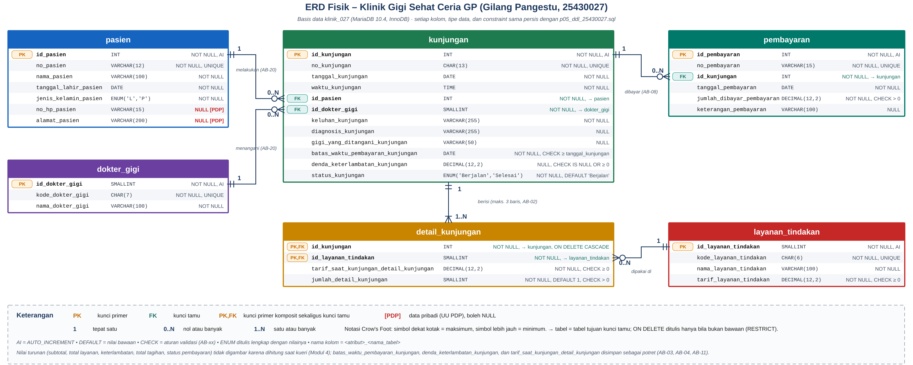

*Gambar 5.21 ERD fisik Klinik Gigi Sehat Ceria GP.*

ERD fisik memenuhi Tabel 5.2: tipe data sama persis dengan DDL termasuk panjang dan presisi, constraint (AI, UNIQUE, NOT NULL/NULL, CHECK, DEFAULT, nilai ENUM) dicantumkan, kunci tamu ditulis dengan tabel tujuannya dan aksi `ON DELETE CASCADE` pada detail_kunjungan, kolom data pribadi diberi tanda [PDP], dan nilai turunan tidak digambar sebagai kolom.

### 6.6 Perbandingan Designer dengan ERD

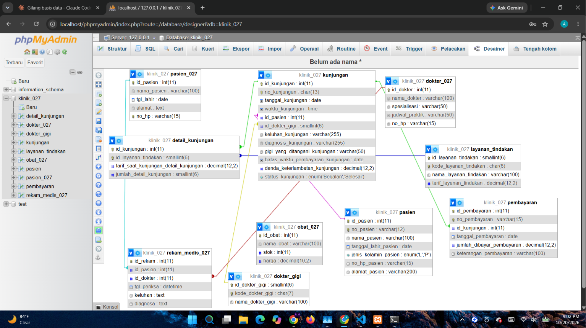

*Gambar 5.22 phpMyAdmin Designer `klinik_027` yang disusun mengikuti ERD Pertemuan 3.*

| Aspek yang dibandingkan | ERD Pertemuan 3 | Designer (desain fisik) | Hasil |
|---|---|---|---|
| Jumlah dan nama tabel | 6 tabel | 6 tabel dengan nama sama | Sesuai |
| Kunci primer | id_* dan komposit pada detail_kunjungan | Sama | Sesuai |
| Relasi | 5 relasi | 5 garis kunci tamu dengan arah yang sama | Sesuai |
| Kolom per tabel | Sesuai kamus data, tanpa atribut turunan | Sama | Sesuai |

Desain fisik sesuai dengan ERD Pertemuan 3, tidak ada perbedaan.

## 7. Pembahasan dan Kendala

Galat yang muncul di pertemuan ini sebagian besar memang sengaja dipancing sebagai bukti constraint.

**Kendala 1: ERROR 1452 saat menambah nota atau kunjungan**
- **Yang terlihat:** `Cannot add or update a child row: a foreign key constraint fails`.
- **Cara membaca:** Nilai kunci tamu (petugas 99, pasien 99) tidak ada di tabel induk. Nama constraint di pesan menunjukkan relasi mana yang dilanggar.
- **Cara mengatasi:** Isi data induk lebih dulu, atau pakai id yang benar-benar ada.

**Kendala 2: ERROR 4025 dan ERROR 1062**
- **Yang terlihat:** `CONSTRAINT ... failed` dan `Duplicate entry ... for key ...`.
- **Cara membaca:** 4025 berarti nilai melanggar CHECK, 1062 berarti nilai kembar pada kunci unik. Karena saya memberi nama constraint yang jelas, aturan yang dilanggar langsung terbaca dari pesan.
- **Cara mengatasi:** Perbaiki nilainya (stok tidak negatif, jumlah lebih dari nol, kode tidak kembar).

**Kendala 3: ERROR 1451 saat DROP TABLE petugas**
- **Yang terlihat:** `Cannot delete or update a parent row`.
- **Cara membaca:** Server menjaga integritas referensial karena `penjualan` masih merujuk `petugas`; server tidak rusak.
- **Cara mengatasi:** Hapus tabel dari anak ke induk, seperti blok `DROP TABLE IF EXISTS` di awal skrip.

**Kendala 4: Lokasi XAMPP dan cara menjalankan skrip**
- **Yang terlihat:** `The system cannot find the path specified` saat `cd C:\xampp\mysql\bin`.
- **Cara membaca:** XAMPP saya terpasang di drive D, bukan C.
- **Cara mengatasi:** Memakai `cd /d D:\xampp\mysql\bin`. Skrip dijalankan dengan `SOURCE` di klien mysql CMD karena `SOURCE` dan `\G` tidak berjalan di tab SQL phpMyAdmin.

**Kendala 5: Menyiapkan bukti E.2 tanpa mengganggu struktur final**
- **Yang terlihat:** Setelah Latihan E.1 dan E.2, tabel `barang` dan `penjualan` berbeda dari versi modul.
- **Cara mengatasi:** Saya menjalankan ulang `p05_ddl_kopma_25430027.sql` di akhir sehingga struktur kembali ke versi final. Ini sekaligus membuktikan skrip dapat diulang.

## 8. Kesimpulan

Constraint mengubah aturan bisnis menjadi jaminan server: data yang melanggar FK, UNIQUE, atau CHECK langsung ditolak dengan kode galat yang jelas (1452, 1062, 4025). Pemilihan tipe data dan urutan pembuatan atau penghapusan tabel sama pentingnya dengan constraint itu sendiri. Saya juga belajar bahwa tidak semua aturan bisa dijaga struktur; aturan yang melibatkan banyak baris, seperti batas tiga layanan per kunjungan, harus ditangani dengan transaksi di Modul 14.

## 9. Pernyataan Penggunaan AI

Saya menggunakan Claude (Anthropic) dalam pengerjaan Modul 5, dengan rincian berikut:

- **Skrip SQL:** Claude membantu menyusun `p05_ddl_kopma_25430027.sql`, `p05_uji_kopma_25430027.sql`, dan `p05_ddl_25430027.sql` berdasarkan skema Modul 4 dan dokumen kebutuhan data saya. Saya memeriksa isinya sebelum menjalankannya.
- **ERD fisik:** Claude membantu menyusun `p05_erd_fisik_25430027.drawio` dan gambarnya dari skrip DDL proyek.
- **Laporan:** Claude menyusun draf laporan ini dari hasil yang saya amati saat menjalankan skrip.

Menjalankan semua perintah di MariaDB, menyusun tabel di phpMyAdmin Designer, mengambil tangkapan layar, serta seluruh perintah Git saya kerjakan sendiri.

## 10. Bukti Git

- Repositori: https://github.com/GilangPangestu098/basisdata-25430027

| Hash Commit | Pesan Commit |
| --- | --- |
| (diisi setelah push) | p05: ddl kopma |
| (diisi setelah push) | p05: ddl proyek klinik dan erd fisik |
| (diisi setelah push) | p05: laporan pertemuan 5 |

## Checklist

**Tabel 5.5 Checklist khusus laporan Pertemuan 5**

| Status | Jenis | Yang harus ada |
| :----: | :---- | :---- |
| ☑️ | Berkas wajib | `p05_ddl_<NIM>.sql` (dapat dijalankan ulang dari basis data kosong) dan ERD fisik `p05_erd_fisik_<NIM>` |
| ☑️ | Bukti tangkapan layar | SHOW CREATE TABLE tabel utama; galat saat constraint dilanggar (FK, UNIQUE, CHECK) |
| ☑️ | Analisis wajib | Alasan pemilihan tipe data dan constraint; kaitan constraint dengan AB-xx |

### Tabel P.13 Checklist umum laporan praktikum

| Status | Butir | Yang harus ada |
| :----: | :---- | :---- |
| ☑️ | Identitas | Nama, NIM, kelas, pertemuan ke-N, tanggal pelaksanaan, nama asisten/dosen |
| ☑️ | Tujuan | Tujuan praktikum ditulis ulang dengan bahasa sendiri (maksimal 5 baris) |
| ☑️ | Ringkasan teori | Pemahaman sendiri atas Dasar Teori, maksimal setengah halaman, tanpa menyalin buku |
| ☑️ | Langkah percobaan (D) | Tangkapan layar hasil langkah kunci sesuai checklist khusus, masing-masing diberi keterangan singkat |
| ☑️ | Titik Analisis | Semua Titik Analisis dijawab lengkap dengan alasan, bukan sekadar ya/tidak |
| ☑️ | Latihan (E) | Skrip/dokumen hasil latihan beserta bukti berjalan |
| ☑️ | Tugas Mandiri (F) | Milestone proyek pertemuan ini: berkas, bukti, dan penjelasan keputusan desain |
| ☑️ | Pembahasan dan kendala | Galat yang ditemui, cara membacanya, dan cara mengatasinya |
| ☑️ | Kesimpulan | Dua sampai empat kalimat dengan bahasa sendiri |
| ☑️ | Pernyataan Penggunaan AI | Alat yang dipakai, untuk apa, bagian mana; tulis "tidak menggunakan" bila tidak memakai |
| ☑️ | Bukti Git | Tautan repositori dan kode commit (hash) pertemuan ini dengan pesan pNN: ... |
| ☑️ | Keaslian | Setiap tangkapan layar memperlihatkan akun ber-NIM dan jam sistem; nama objek memuat NIM/inisial |