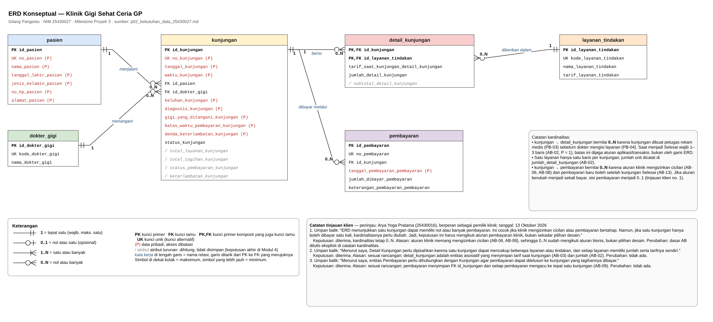

# ERD Proyek - Klinik Gigi Sehat Ceria GP

Disusun oleh: Gilang Pangestu (NIM 25430027), Kelas A. Sumber: `p02_kebutuhan_data_25430027.md`.

Berkas diagram: `p03_erd_25430027.drawio` (sumber) dan `p03_erd_25430027.png` (gambar).

## 1. Entitas, kunci, dan atribut

ERD terdiri atas enam entitas. Setiap entitas memakai kunci primer pengganti `id_<nama_tabel>`, sedangkan nomor atau kode alami dari dokumen kebutuhan menjadi kunci unik (UK).

| Entitas | Kunci primer | Kunci unik | Kunci tamu | Atribut lain |
|---|---|---|---|---|
| pasien | id_pasien | no_pasien (AB-12) | – | nama, tanggal_lahir, jenis_kelamin, no_hp, alamat |
| dokter_gigi | id_dokter_gigi | kode_dokter_gigi | – | nama_dokter_gigi |
| layanan_tindakan | id_layanan_tindakan | kode_layanan_tindakan | – | nama, tarif_layanan_tindakan |
| kunjungan | id_kunjungan | no_kunjungan (AB-01) | id_pasien, id_dokter_gigi | tanggal, waktu, keluhan, diagnosis, gigi_yang_ditangani, batas_waktu_pembayaran, denda_keterlambatan, status_kunjungan |
| detail_kunjungan (asosiatif) | (id_kunjungan, id_layanan_tindakan) | – | id_kunjungan, id_layanan_tindakan | tarif_saat_kunjungan, jumlah |
| pembayaran | id_pembayaran | no_pembayaran (AB-09) | id_kunjungan | tanggal_pembayaran, jumlah_dibayar, keterangan_pembayaran |

**Pemetaan kamus data ke kolom.** Seluruh 31 elemen kamus data tercantum di ERD:

- 26 elemen tercantum dengan nama yang sama.
- 5 elemen kunci tamu yang di kamus ditulis memakai nomor alami diwujudkan sebagai kunci tamu `id_*`:

| Elemen di kamus data | Kolom di ERD |
|---|---|
| `no_pasien_kunjungan` | `kunjungan.id_pasien` |
| `kode_dokter_gigi_kunjungan` | `kunjungan.id_dokter_gigi` |
| `no_kunjungan_detail_kunjungan` | `detail_kunjungan.id_kunjungan` |
| `kode_layanan_tindakan_detail_kunjungan` | `detail_kunjungan.id_layanan_tindakan` |
| `no_kunjungan_pembayaran` | `pembayaran.id_kunjungan` |

**Atribut turunan** ditandai `/` dan tidak disimpan. Keputusan akhirnya diambil di Modul 4.

| Atribut turunan | Cara menghitung |
|---|---|
| `subtotal_detail_kunjungan` | tarif saat kunjungan × jumlah |
| `total_layanan_kunjungan` | jumlah seluruh subtotal pada kunjungan |
| `keterlambatan_kunjungan` | dari batas waktu pembayaran (AB-04) |
| `total_tagihan_kunjungan` | total layanan + denda yang berlaku (AB-05) |
| `status_pembayaran_kunjungan` | dari total tagihan dan pembayaran kumulatif (AB-07) |

**Entitas asosiatif.** `detail_kunjungan` memecah relasi banyak-ke-banyak antara kunjungan dan layanan_tindakan. Satu kunjungan dapat berisi beberapa layanan, dan satu layanan dapat diberikan pada banyak kunjungan. Entitas ini memiliki atribut sendiri, yaitu tarif saat kunjungan (AB-03) dan jumlah unit (AB-02), yang bukan milik kunjungan maupun milik layanan.

## 2. Relasi dan kardinalitas

| Relasi | Sisi kiri | Sisi kanan | Dasar |
|---|---|---|---|
| pasien **menjalani** kunjungan | tepat satu pasien (1) | nol atau banyak kunjungan (0..N) | AB-20; pasien didaftarkan lebih dulu lewat PB-01 sebelum berkunjung (PB-03) |
| dokter_gigi **menangani** kunjungan | tepat satu dokter gigi (1) | nol atau banyak kunjungan (0..N) | AB-20, AB-10 |
| kunjungan **berisi** detail_kunjungan | tepat satu kunjungan (1) | nol atau banyak detail (0..N); 1–3 saat Selesai | AB-02, AB-15 |
| layanan_tindakan **diberikan dalam** detail_kunjungan | tepat satu layanan (1) | nol atau banyak detail (0..N) | AB-03 |
| kunjungan **dibayar melalui** pembayaran | tepat satu kunjungan (1) | nol atau banyak pembayaran (0..N) | AB-08, AB-09, AB-13 |

**Alasan kardinalitas relasi utama:**

- **kunjungan → detail_kunjungan bernilai 0..N, bukan 1..N.** Kunjungan dibuat petugas rekam medis (PB-03) sebelum dokter mencatat layanan (PB-04). Jadi selama status Berjalan, kunjungan sah tanpa detail. Aturan "1–3 baris saat Selesai" (AB-02, P + 2 = 3) tidak bisa digambarkan oleh garis ERD. Aturan ini harus dijaga saat finalisasi kunjungan, misalnya dengan pemeriksaan jumlah baris dalam transaksi (Modul 14).
- **kunjungan → pembayaran bernilai 0..N.** Pembayaran hanya boleh dicatat untuk kunjungan Selesai (AB-13), sehingga kunjungan Berjalan belum punya pembayaran. Pasien juga boleh mencicil (AB-08), sehingga satu kunjungan bisa punya banyak pembayaran. Sebaliknya, setiap pembayaran mengacu ke tepat satu kunjungan (AB-09).
- **Sisi pasien dan dokter bernilai tepat satu.** Kunjungan tanpa pasien atau tanpa dokter yang menangani tidak bermakna dan ditolak (AB-20). Hak baca data kesehatan juga bergantung pada dokter yang terdaftar pada kunjungan (AB-10).
- **Satu layanan hanya satu baris per kunjungan.** Hal ini dijamin oleh kunci primer komposit (id_kunjungan, id_layanan_tindakan). Layanan yang diberikan lebih dari sekali dicatat lewat `jumlah_detail_kunjungan`, sesuai AB-02.

## 3. Penelusuran KI ke jalur ERD

| KI | Kebutuhan informasi | Jalur di ERD | Atribut kunci yang dipakai |
|---|---|---|---|
| KI-01 | Jumlah kunjungan dan nilai layanan per hari atau bulan | kunjungan → detail_kunjungan | tanggal_kunjungan, status_kunjungan = Selesai, tarif_saat × jumlah |
| KI-02 | Tagihan yang melewati batas pembayaran dan denda berjalan | pasien → kunjungan → detail_kunjungan; kunjungan → pembayaran | no_pasien, no_kunjungan, batas_waktu_pembayaran, tarif_saat × jumlah, jumlah_dibayar. Tidak melalui layanan_tindakan (AB-18). |
| KI-03 | Jenis layanan yang paling sering diberikan | layanan_tindakan → detail_kunjungan → kunjungan | kode/nama layanan, jumlah, status_kunjungan = Selesai |
| KI-04 | Jumlah dan nilai pembayaran per periode | pembayaran → kunjungan → detail_kunjungan | tanggal_pembayaran, jumlah_dibayar, nilai tagihan |
| KI-05 | Riwayat pemeriksaan pasien | pasien → kunjungan → dokter_gigi | keluhan, diagnosis, gigi_yang_ditangani, id_dokter_gigi (pembatasan AB-10) |
| KI-06 | Daftar kunjungan yang belum Lunas | pasien → kunjungan → detail_kunjungan; kunjungan → pembayaran | total tagihan dibandingkan dengan pembayaran kumulatif (AB-07) |

Keenam KI dapat ditelusuri, jadi tidak ada entitas, atribut, atau relasi yang kurang.

## 4. Pemetaan entitas ke PB dan KI

| Entitas | Dibuat oleh (C) | Dibaca/diubah oleh | Dipakai di KI |
|---|---|---|---|
| pasien | PB-01 | PB-03, PB-05, PB-06, PB-07 | KI-02, KI-05, KI-06 |
| dokter_gigi | PB-02 | PB-03, PB-06, PB-07 | KI-05 |
| layanan_tindakan | PB-02 | PB-04, PB-06 | KI-03 |
| kunjungan | PB-03 | PB-04, PB-05, PB-06, PB-07 | KI-01 – KI-06 |
| detail_kunjungan | PB-04 | PB-05, PB-06, PB-07 | KI-01, KI-02, KI-03, KI-04, KI-06 |
| pembayaran | PB-05 | PB-06 | KI-02, KI-04, KI-06 |

Setiap entitas dibuat oleh tepat satu proses dan dipakai minimal oleh satu KI, sesuai matriks CRUD Pertemuan 2.

## 5. Catatan tinjauan klien

Peninjau: **Arya Yoga Pratama (25430016)**, teman sekelas yang berperan sebagai pemilik klinik. Tanggal: 13 Oktober 2026. Umpan balik nomor 1 diberikan lewat WhatsApp, sedangkan nomor 2 dan 3 diketik langsung oleh peninjau. Catatan yang sama tertulis di kotak bagian bawah berkas ERD.

| No | Umpan balik (apa adanya) | Keputusan | Alasan | Perubahan pada ERD |
|---|---|---|---|---|
| 1 | "ERD menunjukkan satu kunjungan dapat memiliki nol atau banyak pembayaran. Ini cocok jika klinik mengizinkan cicilan atau pembayaran bertahap. Namun, jika satu kunjungan hanya boleh dibayar satu kali, kardinalitasnya perlu diubah. Jadi, keputusan ini harus mengikuti aturan pembayaran klinik, bukan sekadar pilihan desain." | Diterima, kardinalitas tetap 0..N | Kardinalitas memang harus mengikuti aturan klinik. Aturan klinik mengizinkan pembayaran sebagian dan beberapa transaksi per kunjungan (AB-06, AB-08), dan pembayaran baru boleh setelah kunjungan Selesai (AB-13). Jadi 0..N sudah sesuai aturan bisnis; jika klinik kelak mewajibkan sekali bayar, sisi pembayaran menjadi 0..1. | Kardinalitas tidak diubah. Dasar AB-06, AB-08, dan AB-13 ditulis eksplisit di catatan kardinalitas ERD. |
| 2 | "Menurut saya, Detail Kunjungan perlu dipisahkan karena satu kunjungan dapat mencakup beberapa layanan atau tindakan, dan setiap layanan memiliki jumlah serta tarifnya sendiri." | Diterima | Sesuai rancangan. detail_kunjungan adalah entitas asosiatif yang menyimpan tarif saat kunjungan (AB-03) dan jumlah unit (AB-02) untuk setiap layanan. | Tidak ada (sudah sesuai) |
| 3 | "Menurut saya, entitas Pembayaran perlu dihubungkan dengan Kunjungan agar pembayaran dapat ditelusuri ke kunjungan yang tagihannya dibayar." | Diterima | Sesuai rancangan. pembayaran menyimpan FK id_kunjungan dan setiap pembayaran mengacu ke tepat satu kunjungan (AB-09), sehingga KI-02, KI-04, dan KI-06 dapat ditelusuri. | Tidak ada (sudah sesuai) |
